<div align="center">


# StockLens

### The stock research engine that keeps score.

Every stock site shows you numbers. **StockLens checks them** — it commits a forecast before the
outcome exists, grades itself in public, re-tests every signal on the stock in front of you, and
verifies every figure its AI analyst cites.

[](pyproject.toml)
[](tests)
[](docs/adr/0005-numerics-implemented-not-imported.md)
[](LICENSE)
[](https://anand4286.github.io/stocklens/)
<br>
[](https://github.com/anand4286/stocklens/actions/workflows/ci.yml)
[](https://github.com/anand4286/stocklens/actions/workflows/codeql.yml)
[](https://securityscorecards.dev/viewer/?uri=github.com/anand4286/stocklens)

[**API console**](https://anand4286.github.io/stocklens/) ·
[Architecture](docs/ARCHITECTURE.md) ·
[Quant reference](docs/QUANT.md) ·
[Methodology](docs/METHODOLOGY.md) ·
[Decision records](docs/adr)

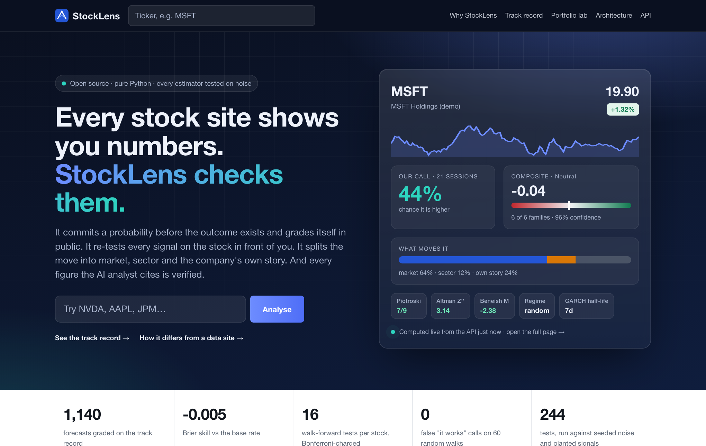

</div>

> Educational software. Nothing here is investment advice. StockLens has no brokerage
> integration and no code path that can place an order.

---

## Contents

1. [Why this exists](#1-why-this-exists)
2. [The core idea: a model that keeps score](#2-the-core-idea-a-model-that-keeps-score)
3. [System architecture](#3-system-architecture)
4. [Inside the engines](#4-inside-the-engines)
5. [How a stock page is built](#5-how-a-stock-page-is-built)
6. [The logic, diagram by diagram](#6-the-logic-diagram-by-diagram)
7. [What you see](#7-what-you-see)
8. [The AI analyst](#8-the-ai-analyst)
9. [Data model](#9-data-model)
10. [How the estimators are tested](#10-how-the-estimators-are-tested)
11. [Security and deployment](#11-security-and-deployment)
12. [Quick start](#12-quick-start)
13. [API](#13-api)
14. [Project layout and documentation](#14-project-layout-and-documentation)
15. [License](#license)

---

## 1. Why this exists

Stock data sites are excellent at **data**: statements, ratios, analyst targets, charts. What none
of them do is **check**. A price target is printed and never graded. An RSI is drawn and never
tested on the stock it is drawn on. A beta is one number with no error bar.

StockLens is not a data terminal and does not try to out-cover one. It answers the questions a data
site cannot:

| Question | A typical stock data site | StockLens |
|---|---|---|
| **Where is it going?** | Analyst target and a rating, never scored | A committed probability — P(higher in 21 sessions) — graded on a public **track record** |
| **Do the indicators work?** | Drawn on a chart | Re-tested **walk-forward on this stock**, with permutation tests, Bonferroni, costs and a deflated Sharpe |
| **What moves it?** | One beta | **Market / sector / own-story** shares with Newey–West t-stats, downside beta, crash co-movement |
| **How bad could it get?** | 52-week range | **GARCH-filtered historical simulation** and market-shock scenarios |
| **Is the business sound?** | Ratios | **Piotroski, Altman, Beneish** with every input, red flags graded by severity, unknown ≠ fail |
| **What is it worth?** | One fair value | The **DCF grid**, the terminal share, and the growth the price already assumes |
| **Is this pattern real?** | — | Base rates and **out-of-sample tests** beside every pattern |
| **Can I trust the AI summary?** | — | Every cited figure **verified** against what its tools returned |

Five design principles run through every line:

| Principle | What it means in code |
|---|---|
| **Noise is the null hypothesis** | Every "is this real?" test is run on seeded random walks and must find nothing at its nominal rate |
| **Missing is not neutral** | A family with no data *abstains* and lowers confidence; it never scores zero |
| **Every number carries its rule** | "Earnings yield 7.3% against a 5% line", never "undervalued" |
| **Withhold below a sample floor** | GARCH needs 250 returns, VaR 100, Sharpe 60; below that the page shows `—` |
| **One report, three consumers** | The page, the AI agent and the evaluator read one object, so they cannot disagree |

---

## 2. The core idea: a model that keeps score

Most analytics stacks end at *"show the number"*. StockLens is organised around what happens next.

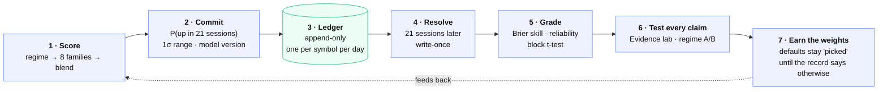

> **Data aggregators stop at step 1.** Steps 2–7 are what make a number on this site checkable.
> On demo data — a factor model with no expected-return signal — the correct verdict is
> *"no skill"*, and the test suite makes sure it stays that way.

---

## 3. System architecture

One stateless FastAPI service. Five engines of pure functions. One report shared by every consumer.

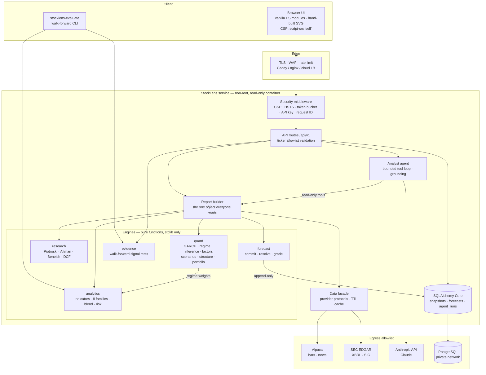

| Layer | Technology | Why this choice |
|---|---|---|
| API | FastAPI, Uvicorn | Typed routes, OpenAPI for free, sync handlers in a thread pool |
| Engines | **Pure Python, standard library only** | Every estimator readable next to its paper; tiny image; no opaque numerics ([ADR 0005](docs/adr/0005-numerics-implemented-not-imported.md)) |
| Agent | Anthropic SDK, Claude | Hand-written loop with step ceiling, strict tool schemas, Pydantic validation, grounding ([ADR 0002](docs/adr/0002-agent-loop.md)) |
| Data | httpx | Pluggable `PriceSource` / `NewsSource` / `FundamentalsSource` protocols |
| Storage | SQLAlchemy Core | SQLite locally, PostgreSQL in production, same code ([ADR 0004](docs/adr/0004-storage.md)) |
| UI | Vanilla ES modules, SVG | No CDN, no framework, no build step ([ADR 0003](docs/adr/0003-no-frontend-framework.md)) |
| Ops | Docker, Compose, K8s, systemd | Templates for Cloud Run, AWS, Azure, a plain VM |

### The dependency rule

Engines never import providers, the framework, the database or the agent. They receive plain
dataclasses (`Bar`, `NewsItem`, `Fundamentals`) and return JSON-ready dicts. That single rule is what
makes them unit-testable without mocks and lets the page, the agent and the backtest share one report.

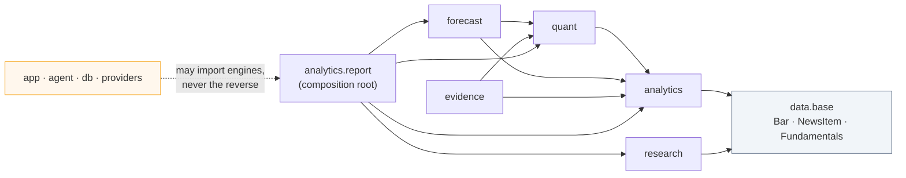

---

## 4. Inside the engines

| Package | Lines | What it answers | Key methods |
|---|---:|---|---|
| `analytics/` | 918 | What is the composite score, and exactly why? | Wilder RSI, 12-1 momentum, historical VaR/ES, R/S Hurst, Lo–MacKinlay VR |
| `quant/` | 3,600 | How volatile, in what regime, driven by what, and how bad could it get? | GARCH(1,1) MLE · Parkinson / Garman–Klass · PSR / DSR · Newey–West OLS · filtered historical simulation · Ledoit–Wolf · Marchenko–Pastur · Jacobi eigensolver · FISTA · ERC · HRP |
| `research/` | 1,075 | Are the accounts sound, and what does the price assume? | Piotroski F · Altman Z / Z'' · Beneish M (8/5-variable) · Sloan accruals · graded red flags · DCF grid · reverse DCF |
| `forecast/` | 756 | What did we predict, and were we right? | Shrunk logistic map · Brier skill vs climatology · reliability bins with Wilson intervals · block t-test |
| `evidence/` | 596 | Does any signal actually work on *this* stock? | Rank IC on non-overlapping days · permutation and circular-shift tests · Bonferroni · after-cost rules · deflated Sharpe |
| `agent/` | 610 | What would a careful analyst write from these numbers? | 10 read-only tools · terminal `submit_report` · cited-figure verification |
| `data/` | 1,132 | Where do bars, news and filings come from? | Alpaca · SEC XBRL + SIC · sector map · factor-model demo generator |

---

## 5. How a stock page is built

One request, about 250 ms, every step deterministic for a given day's data.

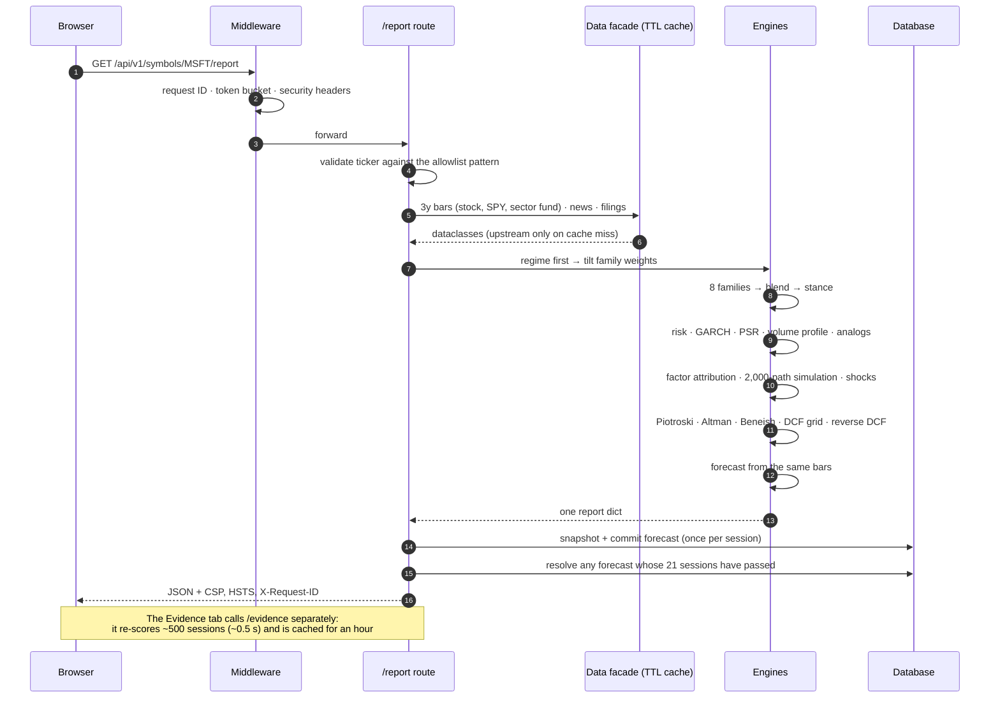

---

## 6. The logic, diagram by diagram

### 6.1 Scoring: regime first, then evidence

The same RSI reading means opposite things in a trending and a mean-reverting market, so the regime
is read **before** the families are blended.

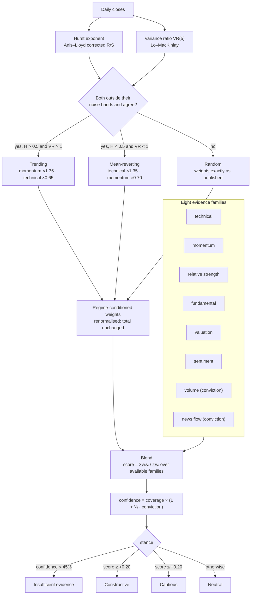

Every directional family's contribution is printed, and they **sum to the composite** — every point
of the score is attributable. Formulas: [METHODOLOGY.md](docs/METHODOLOGY.md) · regime: [ADR 0006](docs/adr/0006-regime-conditioned-weights.md).

### 6.2 The forecast lifecycle

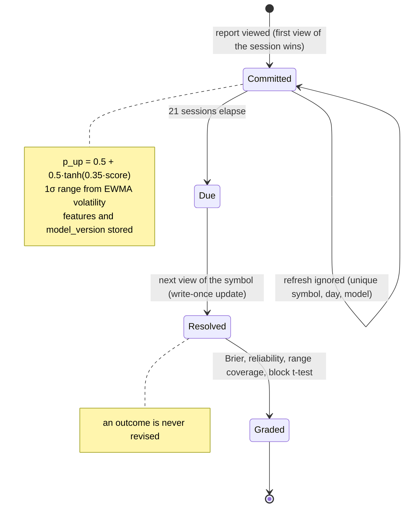

**"Skill" needs all three:** Brier skill > 0 against quoting the base rate, a hit-rate interval
above 50% on the *effective* sample (distinct decision days), **and** t ≥ 2 across independent
21-session blocks. The third test exists because a 5-stock random basket once passed the first two
by luck — twelve forecasts on one morning share one market. [ADR 0007](docs/adr/0007-forecast-ledger.md)

### 6.3 The Evidence lab: does a signal really work here?

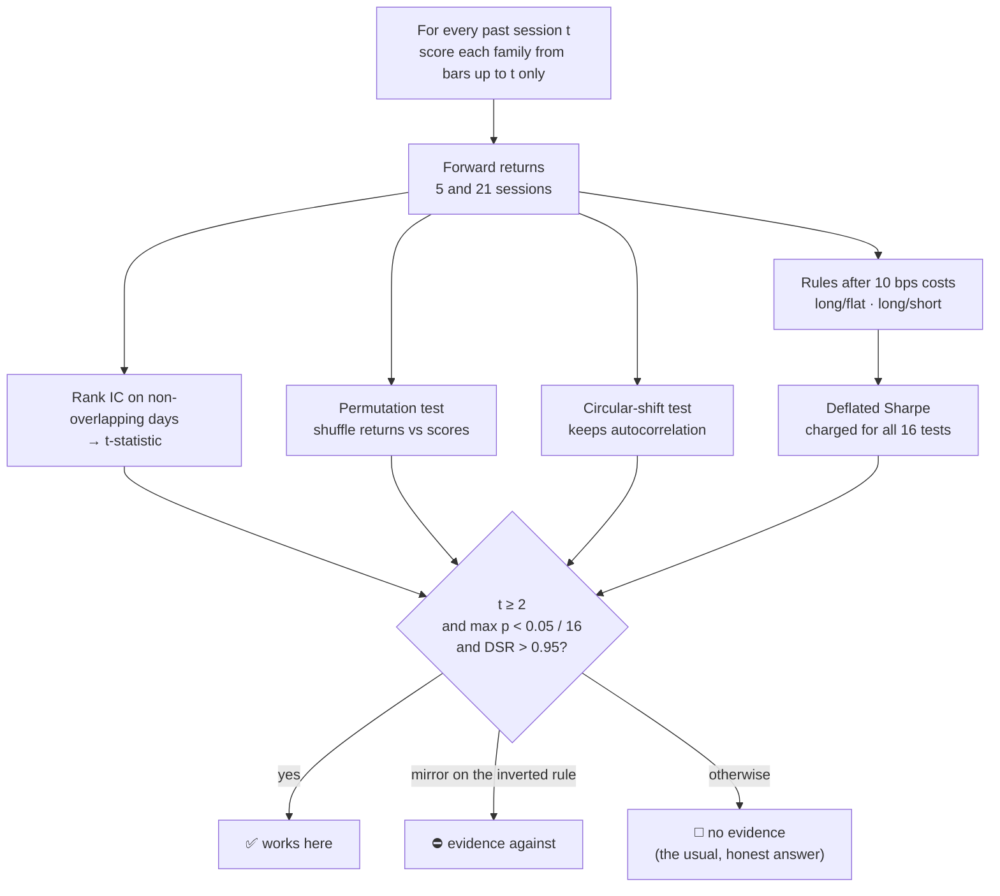

The circular-shift test was added after measuring the permutation test alone at a **7–9% false-positive
rate** on random walks. With both, 60 random series produce **zero** false "works".

### 6.4 Drivers: what moves the price, and how bad it could get

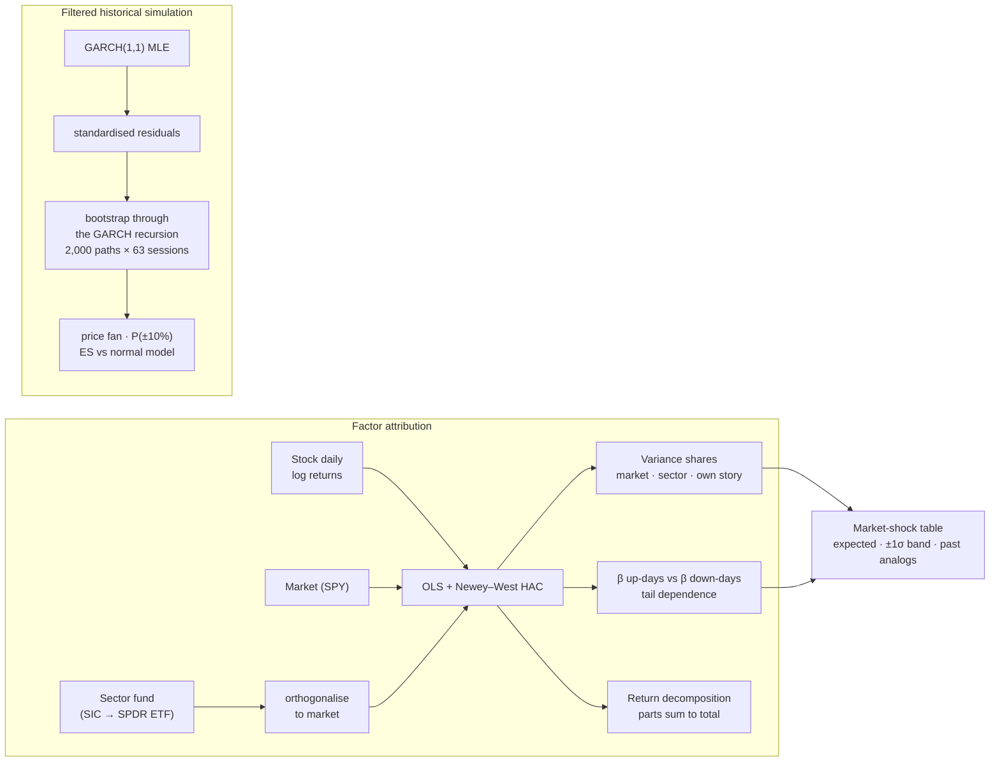

### 6.5 The portfolio lab: how many bets is a basket really?

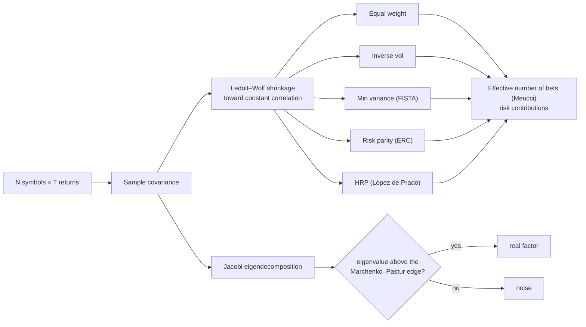

Every method, formula and reference: [docs/QUANT.md](docs/QUANT.md).

---

## 7. What you see

Every stock has a page at `/s/{TICKER}` with eleven tabs, plus `/track-record`, `/portfolio`, `/why`
and `/architecture`.

<table>
<tr>
<td width="50%"><b>Evidence</b> — every signal tested on this stock's own history<br>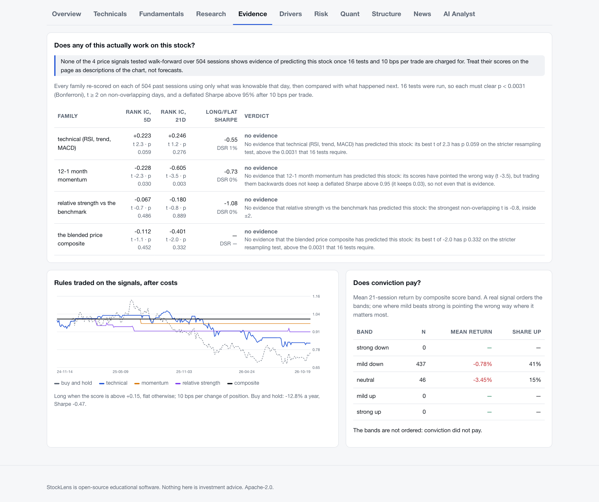</td>
<td width="50%"><b>Drivers</b> — factor attribution, shocks, simulated price fan<br>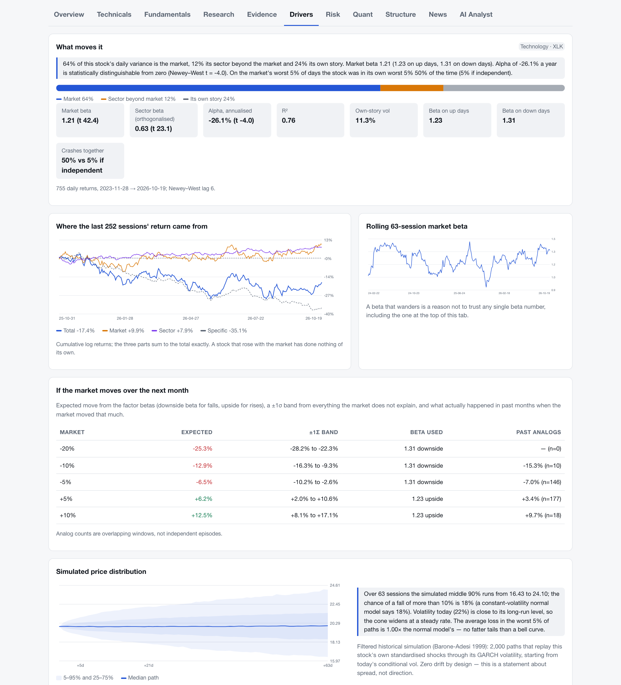</td>
</tr>
<tr>
<td><b>Track record</b> — Brier skill, reliability curve, block t-test<br>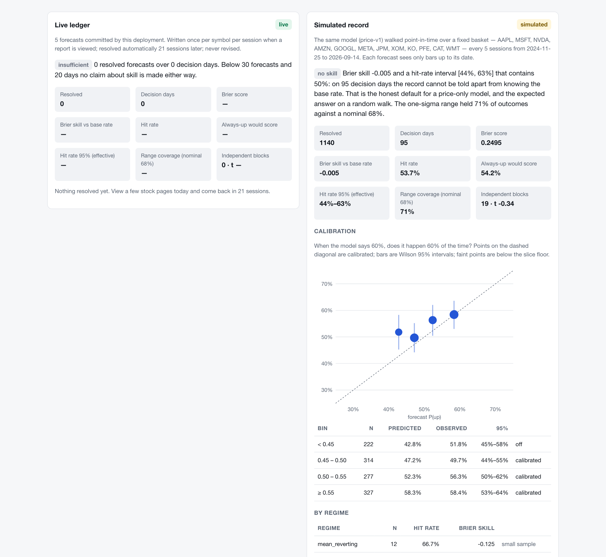</td>
<td><b>Research</b> — forensic scores, graded red flags, DCF grid<br>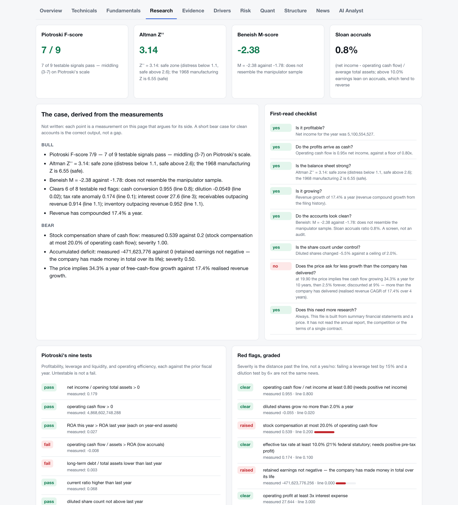</td>
</tr>
<tr>
<td><b>Quant</b> — regime, GARCH, volatility cone, probabilistic Sharpe<br>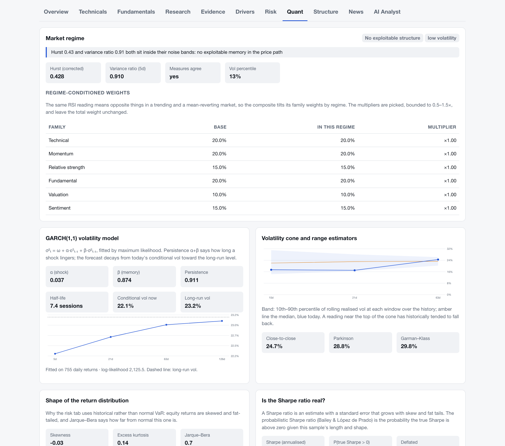</td>
<td><b>Portfolio lab</b> — spectrum vs noise and five weighting methods<br>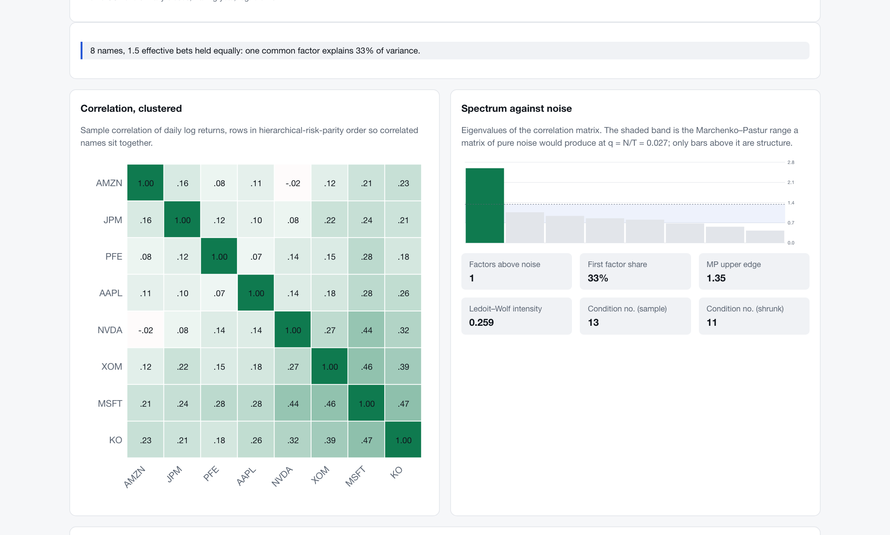</td>
</tr>
</table>

| Tab | What it shows |
|---|---|
| **Our call** (header) | The committed forecast — P(up in 21 sessions), 1σ range, commit/resolve dates — beside this stock's record |
| **Overview** | Price with SMA 20/50 and Bollinger bands; contributions that sum to the composite |
| **Technicals** | RSI, MACD, moving averages, stochastic, ATR — each with a plain-language reading |
| **Fundamentals** | Annual figures from SEC XBRL and eight balance-sheet checks; unknown ≠ fail |
| **Research** | Piotroski, Altman Z''/Z, Beneish M, Sloan accruals, graded red flags, multiples, DCF grid, reverse DCF, a derived bull/bear case |
| **Evidence** | Walk-forward rank IC, permutation and shift p-values, bands, by year and regime, after-cost equity curves, deflated Sharpe |
| **Drivers** | Variance shares, Newey–West betas, return decomposition, rolling beta, downside beta, crash co-movement, shocks, price fan |
| **Risk** | Volatility, drawdown, historical VaR/ES, Sharpe, Sortino, beta, Hurst, variance ratio, 1σ range |
| **Quant** | Regime and its weights, GARCH fit and forecast, range estimators, volatility cone, distribution shape, PSR/DSR |
| **Structure** | Volume at price with an out-of-sample level test; shape analogs against their base rate |
| **News** | Headlines with a transparent finance-lexicon tone score |
| **AI Analyst** | A verified note, the verification panel and the full tool trace |

---

## 8. The AI analyst

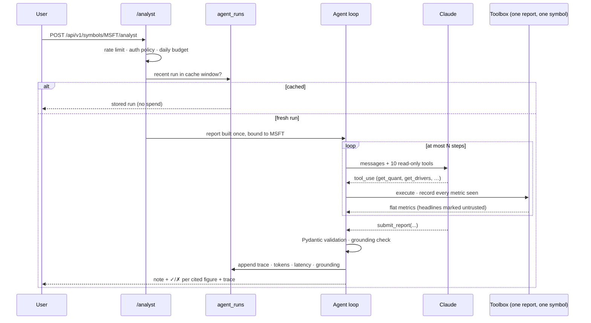

| Guardrail | How |
|---|---|
| **Least privilege** | Ten read-only tools bound server-side to one symbol; none accepts a ticker, URL or query |
| **Grounding** | Every figure cited must match a value a tool actually returned (1% tolerance); mismatches are shown |
| **Injection containment** | Headlines arrive in an `untrusted_headlines` envelope; nothing the agent can call writes or fetches |
| **Bounded cost** | Step ceiling, per-symbol cache, daily budget counted in the database, per-client rate limit |
| **Graceful degradation** | Every stop reason handled; any failure falls back to a deterministic rules brief, still audited |

Tools: `get_overview` · `get_signal_breakdown` · `get_technicals` · `get_fundamentals` · `get_risk` ·
`get_quant` · `get_market_structure` · `get_research` · `get_drivers` · `get_news` → `submit_report`.
Details: [docs/AGENT.md](docs/AGENT.md).

---

## 9. Data model

All three tables are append-only. The forecast ledger is resolved exactly once.

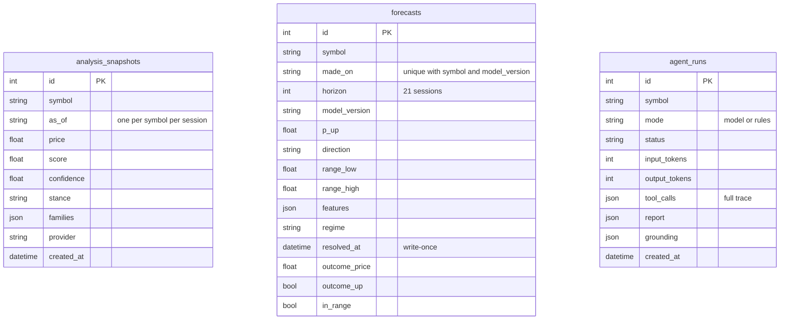

---

## 10. How the estimators are tested

Each estimator is tested twice: on a **seeded null**, where it must find nothing, and on a
**planted signal**, where it must find it. 248 tests, about 20 seconds, no network.

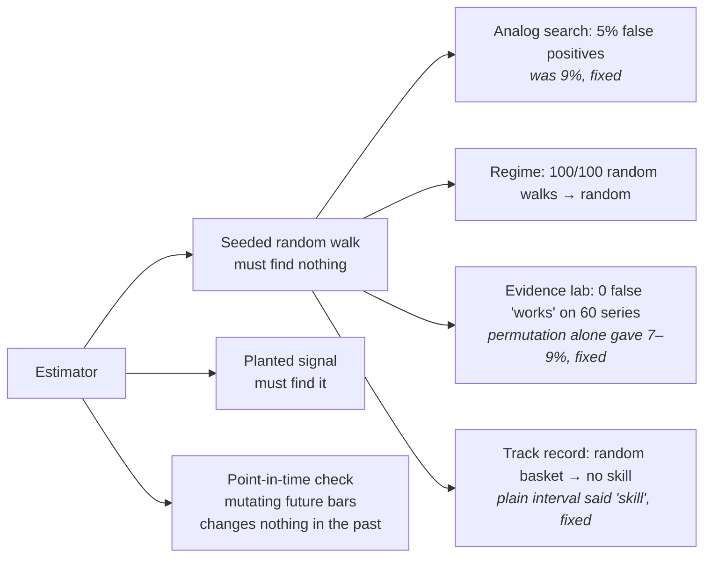

Three of those four were real bugs this approach caught, and each is now a regression test.

---

## 11. Security and deployment

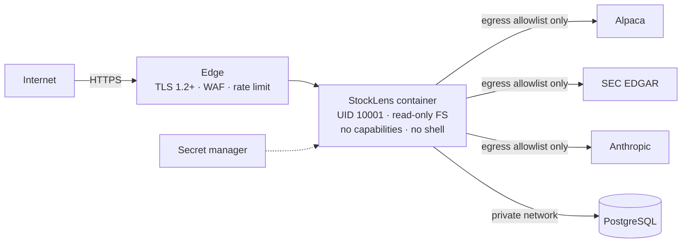

| Control | Where |
|---|---|
| Strict CSP (`script-src 'self'`, no inline script or style), HSTS, frame-deny, nosniff | `security.py`, tested |
| Token-bucket rate limits (API and a tighter one for the agent), constant-time API key | `security.py` |
| Ticker allowlist before any upstream URL; secrets as `SecretStr`, never logged | `data/base.py`, `config.py` |
| XSS-safe UI: every node built with `textContent` | `web/static/*.js` |
| Non-root, read-only, capabilities dropped; default-deny NetworkPolicy; host firewall deny in and out | `Dockerfile`, `deploy/` |
| Per-client compute limit on history-rescoring endpoints; daily cap on ledger writes; CORS exact-origin validation | `app.py`, `config.py`, tested |
| Upstream URLs never logged; secrets never in `repr`, logs or error bodies | `logging_setup.py`, `config.py`, tested |
| **Supply chain:** every GitHub Action pinned to a commit SHA, Dependabot, pip-audit, CycloneDX SBOM, Trivy, CodeQL security-extended, gitleaks on full history, OpenSSF Scorecard | `.github/` |

| Target | Template |
|---|---|
| Docker Compose (app + PostgreSQL + Caddy auto-TLS) | `docker-compose.yml` |
| Ubuntu VM (nginx, systemd, ufw) | `deploy/vm/` |
| Kubernetes (NetworkPolicy, HPA, PDB) | `deploy/k8s/` |
| Google Cloud Run · AWS App Runner/ECS · Azure Container Apps | `deploy/cloudrun/`, `deploy/aws/`, `deploy/azure/` |

**No secrets live in this repository.** Every credential is optional, read only from the
environment or a secret manager, and the app runs fully offline in demo mode with none.
Reporting a vulnerability and the deployer checklist: [SECURITY.md](SECURITY.md) ·
threat model: [SECURITY_ARCHITECTURE.md](docs/SECURITY_ARCHITECTURE.md) ·
step by step: [DEPLOYMENT.md](docs/DEPLOYMENT.md).

---

## 12. Quick start

```bash
git clone https://github.com/anand4286/stocklens.git && cd stocklens
python3 -m venv .venv && source .venv/bin/activate
pip install -e ".[dev]"
uvicorn --factory stocklens.app:app_factory --port 8080
```

Open <http://127.0.0.1:8080>. **No keys needed** — demo mode generates a deterministic factor-model
market (market + sector + GARCH noise) per ticker, so links are stable and nothing real is exposed.

**Real data** (all optional, all free tiers):

```bash
cp .env.example .env
# STOCKLENS_DATA_PROVIDER=alpaca + Alpaca market-data keys   → real prices and news
# STOCKLENS_SEC_USER_AGENT="Your Name you@example.com"        → real fundamentals and SIC sectors
# STOCKLENS_ANTHROPIC_API_KEY=...                              → the Claude analyst
```

**Docker** (app + PostgreSQL + Caddy with automatic HTTPS):

```bash
echo "POSTGRES_PASSWORD=$(openssl rand -hex 24)" >> .env
SITE_ADDRESS=localhost docker compose up -d --build
```

**Checks:** `pytest` · `ruff check src tests` · `bandit -r src -c pyproject.toml` ·
**Evaluate:** `stocklens-evaluate --symbols AAPL MSFT NVDA JPM XOM KO --horizon 5`

---

## 13. API

Interactive console with live example responses: **<https://anand4286.github.io/stocklens/>** ·
Swagger on any running instance at `/docs`.

| Method | Path | Purpose |
|---|---|---|
| `GET` | `/api/v1/symbols/{symbol}/report` | Everything the page shows, including `forecast`, `quant`, `drivers`, `structure`, `research` |
| `GET` | `/api/v1/symbols/{symbol}/evidence` | Walk-forward tests of every price family on this stock |
| `GET` | `/api/v1/symbols/{symbol}/forecasts` | This symbol's live ledger and simulated record |
| `GET` | `/api/v1/track-record` | Every committed forecast, scored, beside the simulated record |
| `GET` | `/api/v1/portfolio?symbols=A,B,…` | Spectrum vs noise and five weighting methods |
| `POST` | `/api/v1/symbols/{symbol}/analyst` | The verified AI analyst note |
| `GET` | `/api/v1/symbols/{symbol}/history` · `/api/v1/meta` | Snapshot ledger · version, sources, agent mode |
| `GET` | `/healthz` · `/readyz` | Liveness · readiness including the database |

```bash
curl -s localhost:8080/api/v1/symbols/MSFT/report \
  | jq '{call: .forecast.p_up, regime: .quant.regime.trend, beta: .drivers.attribution.market_beta.value}'
```

Reference: [docs/API.md](docs/API.md). Regenerate the console with `python scripts/build_docs_site.py`.

---

## 14. Project layout and documentation

```
src/stocklens/
  app.py         routes and the agent endpoint policy        security.py   headers, limits, auth
  analytics/     indicators · 8 families · blend · risk · report builder
  quant/         volatility · regime · inference · factors · scenarios · volume_profile
                 similarity · linalg · covariance · portfolio
  research/      forensics · valuation · derived debate
  forecast/      model · ledger · scoring · simulated record
  evidence/      walk-forward signal tests
  agent/         tools · loop · prompts · rules fallback
  data/          provider protocols · Alpaca · SEC EDGAR · sectors · demo generator · TTL cache
  web/           six pages and eleven tabs as vanilla ES modules
scripts/         build_docs_site.py — generates the API console from the live OpenAPI spec
site/            the generated API console (deployed to GitHub Pages)
deploy/          caddy · nginx · systemd · vm · k8s · cloudrun · aws · azure
docs/            architecture · methodology · quant · agent · security · deployment · API · ADRs
tests/           248 tests: nulls and planted signals, point-in-time, security, agent, API
```

| Document | What it covers |
|---|---|
| [ARCHITECTURE.md](docs/ARCHITECTURE.md) | Components, request and agent flows, state, extension points |
| [QUANT.md](docs/QUANT.md) | Every deep-analytics method with formulas, floors and references |
| [METHODOLOGY.md](docs/METHODOLOGY.md) | The eight families, the blend and the risk statistics |
| [AGENT.md](docs/AGENT.md) | Agent design, guardrails, failure modes, cost controls |
| [SECURITY_ARCHITECTURE.md](docs/SECURITY_ARCHITECTURE.md) | STRIDE threat model, network and firewall design |
| [DEPLOYMENT.md](docs/DEPLOYMENT.md) | Every deployment target, step by step |
| [API.md](docs/API.md) | Endpoint reference with response shapes |
| [adr/](docs/adr) | Seven architecture decision records, including why there is no NumPy and why the forecast ledger is write-once |

---

## License

StockLens is open source under the **[Apache License 2.0](LICENSE)** — free to use, modify and
distribute, including commercially, with attribution and a patent grant. See [NOTICE](NOTICE).
Copyright 2026 [anand4286](https://github.com/anand4286).

It is educational software: nothing it produces is investment advice, and it contains no
brokerage integration or order path. Market data, filings and model outputs come from the
providers a deployer configures, under their own terms; none is distributed with this code.

<div align="center">

**Apache-2.0** · Contributions welcome — see [CONTRIBUTING.md](CONTRIBUTING.md) · Security: [SECURITY.md](SECURITY.md)

*Built on one idea: a tool that finds an edge in noise is broken — so test it on noise.*

</div>
