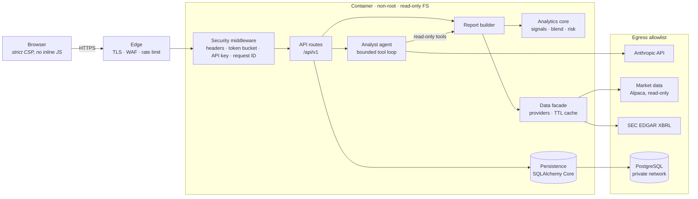
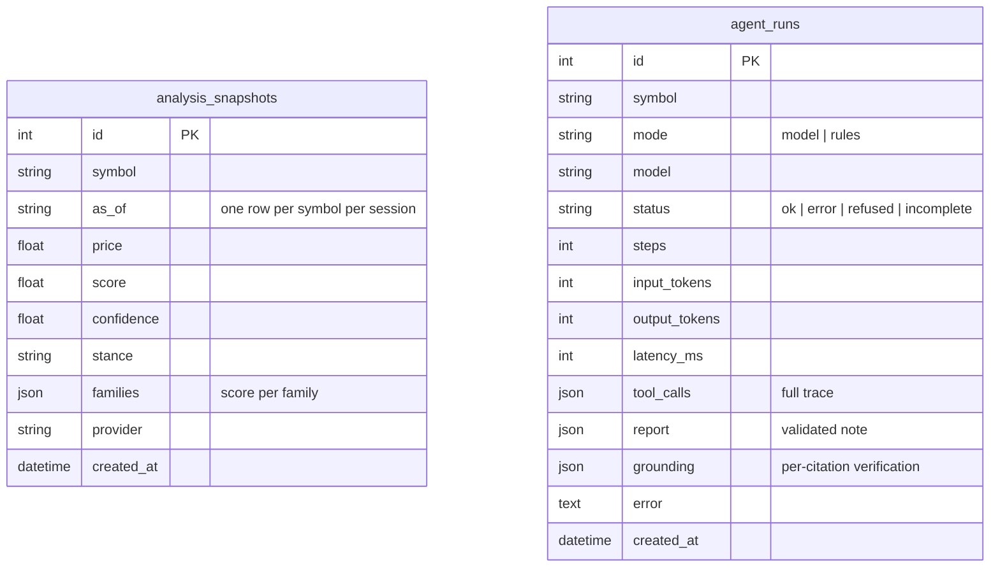
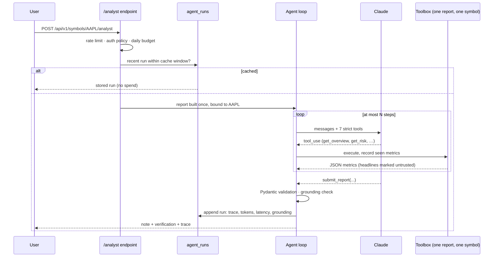

# StockLens

**Stock analytics that show their working — with an AI analyst agent whose every number is checked.**

StockLens scores any US-listed stock on eight independent families of evidence,
blends them with published weights, and shows exactly how each family moved
the result. A Claude-powered analyst agent then writes a research note using
read-only tools, and every figure it cites is verified against what those tools
actually returned.

It runs anywhere — offline on synthetic data with zero keys, or on real market
data and SEC filings with your own free credentials — and ships with
deployment templates, firewall rules and CI security gates for every common
target.

> Educational software. Nothing here is investment advice. StockLens has no
> brokerage integration and no code path that can place an order.


---

## Contents

- [What it does](#what-it-does)
- [Quick start](#quick-start)
- [Architecture](#architecture)
- [How the score works](#how-the-score-works)
- [The AI analyst agent](#the-ai-analyst-agent)
- [Security](#security)
- [Deployment](#deployment)
- [API](#api)
- [Evaluation: the honest metric](#evaluation-the-honest-metric)
- [Project layout](#project-layout)
- [Documentation](#documentation)

## What it does

Every stock has a page at `/s/{TICKER}` with six tabs:

| Tab | What it shows |
|---|---|
| **Overview** | Price with SMA 20/50 and Bollinger bands, key figures, and a per-family breakdown whose contributions sum to the composite score |
| **Technicals** | RSI(14), MACD(12,26,9), moving averages, Bollinger, stochastic, ATR — each with a plain-language reading |
| **Fundamentals** | Latest annual figures from SEC XBRL filings and eight pass/fail balance-sheet checks, with "unknown" kept distinct from "fail" |
| **News** | Recent headlines with a transparent finance-lexicon tone score |
| **Risk** | Volatility (historical and EWMA), max drawdown, historical VaR and expected shortfall, Sharpe, Sortino, beta, Hurst exponent, variance ratio, and a one-sigma price range by horizon |
| **AI Analyst** | An agent-written note with stance, bull/bear case and risks, a verification panel for every cited figure, and the full tool-call trace with token usage |

Design principles, enforced in code and tests:

- **Missing is not neutral.** A family with no data abstains; it lowers confidence instead of quietly scoring zero.
- **Every number carries its rule.** "Earnings yield 7.3%, FCF yield -1.9%", never just "undervalued".
- **Withhold below a sample floor.** VaR needs 100 observations, Sharpe 60, Hurst 128. Below that the page shows `—`.
- **One report, three consumers.** The page, the agent and the evaluation harness read the same computed report, so they can never disagree.

## Quick start

```bash
git clone <repository-url> stocklens && cd stocklens
python3 -m venv .venv && source .venv/bin/activate
pip install -e ".[dev]"
uvicorn --factory stocklens.app:app_factory --port 8080
```

Open <http://127.0.0.1:8080/s/AAPL>. No keys needed — demo mode generates a
deterministic, realistic series per ticker (GARCH-style volatility clustering),
so links are stable and nothing real is exposed.

**Real data** (all optional, all free tiers):

```bash
cp .env.example .env
# STOCKLENS_DATA_PROVIDER=alpaca + Alpaca market-data keys  -> real prices and news
# STOCKLENS_SEC_USER_AGENT="Your Name you@example.com"       -> real fundamentals from SEC EDGAR
# STOCKLENS_ANTHROPIC_API_KEY=...                             -> the Claude analyst agent
```

**Full stack with Docker** (app + PostgreSQL + Caddy with automatic HTTPS):

```bash
cp .env.example .env
echo "POSTGRES_PASSWORD=$(openssl rand -hex 24)" >> .env
SITE_ADDRESS=localhost docker compose up -d --build
```

**Tests:** `pytest` (77 tests, no network). **Lint/security:** `ruff check src tests && bandit -r src -c pyproject.toml`.

## Architecture



| Layer | Technology | Notes |
|---|---|---|
| API | FastAPI, Uvicorn | Sync handlers run in a thread pool; OpenAPI at `/openapi.json`, Swagger at `/docs` |
| Analytics | Pure Python | No I/O, no framework imports; every function unit-tested |
| Agent | Anthropic Python SDK, Claude Opus 5.5 | Hand-written loop with step ceiling, strict tool schemas, Pydantic validation, grounding check |
| Data | httpx | Pluggable `PriceSource` / `NewsSource` / `FundamentalsSource` protocols; demo, Alpaca, SEC EDGAR |
| Storage | SQLAlchemy Core | SQLite by default, PostgreSQL in production — same code |
| UI | Vanilla ES modules, SVG charts | No CDN, no framework, no build step; every node built with `textContent` |
| Ops | Docker, Compose, Kubernetes, systemd | Templates for Cloud Run, AWS App Runner/ECS, Azure Container Apps |

More: [docs/ARCHITECTURE.md](docs/ARCHITECTURE.md), and the live page at `/architecture`.

### Data model



Both tables are append-only. `analysis_snapshots` is a forecast ledger:
written before anyone knows the outcome, it is the unbiased sample an
evaluation needs. `agent_runs` is the audit trail an AI feature needs before
anyone should trust it.

## How the score works

Each family returns a score in **[-1, +1]** or abstains.

| Family | Kind | Question | Rule |
|---|---|---|---|
| `technical` | directional | Is price stretched? | 0.6 × RSI reversion + 0.2 × distance from SMA20 + 0.2 × MACD histogram |
| `momentum` | directional | Is the trend persistent? | 12-1 month return (Jegadeesh & Titman), ±40% saturates, plus 50/200-day alignment |
| `relative_strength` | directional | Is it beating the market? | 63-session excess return vs the benchmark, ±20pp saturates |
| `fundamental` | directional | Is the balance sheet sound? | (passed − failed) / answered over 8 filing checks; abstains below 4 answered |
| `valuation` | directional | Is the price defensible? | Earnings and FCF yield against a 2%–8% band |
| `sentiment` | directional | How does coverage read? | Recency-weighted (3-day half-life) finance-lexicon tone; needs 3 toned headlines |
| `volume` | conviction | Is participation unusual? | Last session vs 20-day average |
| `news_flow` | conviction | Is coverage unusual? | 3-day article count vs 14-day rate, in doublings |

```
score      = Σ wᵢ·sᵢ / Σ wᵢ                 over available directional families
coverage   = Σ w(available) / Σ w(all)
confidence = coverage × (1 + 0.25 × mean(conviction families)),  clamped to [0, 1]
stance     = Constructive ≥ +0.20 · Cautious ≤ −0.20 · Neutral otherwise · none below 45% confidence
```

Weights are published defaults, not fitted claims. Full derivations and
references: [docs/METHODOLOGY.md](docs/METHODOLOGY.md).

## The AI analyst agent



What makes it production-grade rather than a demo:

- **Least privilege.** Six read-only tools plus a terminal `submit_report`, all bound server-side to one symbol. No tool accepts a ticker, URL or query, so neither a user nor a headline can redirect it.
- **Structured, validated output.** The note arrives through a `submit_report` tool with a strict JSON schema, then is re-validated with Pydantic; a malformed submission goes back to the model as a tool error it can correct.
- **Grounding verification.** Tools return metrics under dotted paths (`risk.volatility_annual`). The note must cite at least three; each is checked against the value the agent actually retrieved (1% tolerance). Invented or never-retrieved figures are flagged on the page.
- **Prompt-injection containment.** Headlines arrive in an `untrusted_headlines` envelope; the system prompt states they are data; and since every tool is read-only and symbol-bound, a successful injection has nothing to act on.
- **Bounded cost.** Step ceiling, per-symbol result cache, a daily run budget counted in the database (so it holds across restarts and replicas), a per-client rate limit, and model runs off for anonymous users by default.
- **Every stop reason handled.** `tool_use`, `end_turn`, `max_tokens`, `pause_turn` and `refusal` each have a defined outcome; the server-side refusal fallback is enabled; any failure degrades to the deterministic rules brief and is still logged.
- **Full audit trail.** Every run — successful or not — records the tool trace, token usage, latency and grounding score.

Without an Anthropic key, a deterministic rules engine produces the same note
contract from the same numbers. Details: [docs/AGENT.md](docs/AGENT.md).

## Security

| Control | Where |
|---|---|
| Strict Content-Security-Policy (`script-src 'self'`, no inline script or style, `connect-src 'self'`), HSTS, `X-Frame-Options: DENY`, nosniff, COOP/CORP | `security.py`, checked by tests |
| Token-bucket rate limit per client (API) plus a tighter one for the agent | `security.py`, plus edge limits in every template |
| Optional bearer API key, compared in constant time | `security.py` |
| Ticker allowlist regex at the edge — no user input reaches an upstream URL unvalidated | `data/base.py` |
| Secrets as `SecretStr`, never logged; upstream error bodies never echoed | `config.py`, `data/*.py` |
| Generic 500s with a request ID; stack traces only in logs | `security.py` |
| XSS-safe UI: every node built with `textContent`; news links restricted to http(s) | `web/static/*.js` |
| Non-root (UID 10001), read-only root FS, all capabilities dropped, no-new-privileges | `Dockerfile`, Compose, K8s, ECS |
| Default-deny NetworkPolicy; ingress only from the controller; egress only DNS, DB, HTTPS | `deploy/k8s/networkpolicy.yaml` |
| Host firewall: default deny in *and* out | `deploy/vm/firewall.sh` |
| CI gates: ruff, bandit, pip-audit, gitleaks, Trivy, CodeQL, Dependabot | `.github/` |

Threat model (STRIDE) and firewall design: [docs/SECURITY_ARCHITECTURE.md](docs/SECURITY_ARCHITECTURE.md).
Reporting a vulnerability: [SECURITY.md](SECURITY.md).

## Deployment

| Target | Template | Edge / firewall |
|---|---|---|
| Laptop | `uvicorn --factory stocklens.app:app_factory` | — |
| Docker Compose | `docker-compose.yml` | Caddy (auto-TLS); DB on an internal network with no egress |
| Single VM (Ubuntu) | `deploy/vm/install.sh` | nginx (TLS, `limit_req`), hardened systemd unit, ufw default-deny both ways |
| Kubernetes | `deploy/k8s/` (kustomize) | ingress-nginx + cert-manager, NetworkPolicy, PSA `restricted`, HPA, PDB |
| Google Cloud Run | `deploy/cloudrun/deploy.sh` | Secret Manager; HTTPS LB + Cloud Armor (`cloud-armor.sh`) |
| AWS | `deploy/aws/` | App Runner or ECS Fargate behind ALB; WAF; least-privilege security groups |
| Azure | `deploy/azure/` | Container Apps; Front Door WAF; Key Vault |

Step-by-step for each: [docs/DEPLOYMENT.md](docs/DEPLOYMENT.md).

## API

| Method | Path | Purpose |
|---|---|---|
| `GET` | `/api/v1/meta` | Version, data sources, weights, agent mode |
| `GET` | `/api/v1/symbols/{symbol}/report` | Everything the page shows: quote, composite, technicals, risk, fundamentals, news, chart series |
| `GET` | `/api/v1/symbols/{symbol}/history` | Recorded composite snapshots (the forecast ledger) |
| `POST` | `/api/v1/symbols/{symbol}/analyst` | Run (or return the cached) analyst note |
| `GET` | `/healthz`, `/readyz` | Liveness; readiness including the database |

```bash
curl -s localhost:8080/api/v1/symbols/MSFT/report | jq '.composite | {score, confidence, stance}'
```

Full reference with response shapes and error codes: [docs/API.md](docs/API.md).

## Evaluation: the honest metric

Directional accuracy flatters any model in a rising market, so the harness
reports the numbers that convert to money: **rank IC** with a t-statistic on
non-overlapping days, **top-minus-bottom spread**, and **hit rate next to the
"always up" base rate**.

```bash
stocklens-evaluate --symbols AAPL MSFT NVDA JPM XOM KO --horizon 5
```

On demo data — a random walk by construction — it correctly reports no edge
(IC ≈ 0, |t| < 2). That is the point: a harness that finds an edge in noise
is broken. Only price families are evaluated, because the free filings and
news sources are not point-in-time and would leak the future.

## Project layout

```
src/stocklens/
  app.py            FastAPI app factory, routes, agent endpoint policy
  security.py       headers, rate limiter, API-key auth, request IDs
  config.py         typed settings (pydantic-settings), secrets as SecretStr
  db.py             SQLAlchemy Core tables and queries
  evaluate.py       walk-forward evaluation harness (CLI)
  data/             provider protocols + demo, Alpaca, SEC EDGAR adapters, TTL cache
  analytics/        indicators, signal families, blend, risk, report builder
  agent/            tools, loop, prompts, rules fallback
  web/              HTML pages and static ES modules (no build step)
deploy/             caddy, nginx, systemd, vm, k8s, cloudrun, aws, azure
docs/               architecture, methodology, agent, security, deployment, API, ADRs
tests/              77 tests: maths, security, agent loop, API, parsers
```

## Documentation

- [ARCHITECTURE.md](docs/ARCHITECTURE.md) — components, request and agent flows, design decisions
- [METHODOLOGY.md](docs/METHODOLOGY.md) — every formula, threshold and reference
- [AGENT.md](docs/AGENT.md) — agent design, guardrails, failure modes, cost controls
- [SECURITY_ARCHITECTURE.md](docs/SECURITY_ARCHITECTURE.md) — threat model, network and firewall design
- [DEPLOYMENT.md](docs/DEPLOYMENT.md) — every target, step by step
- [API.md](docs/API.md) — endpoint reference
- [adr/](docs/adr) — architecture decision records

## License

Apache-2.0. See [LICENSE](LICENSE).
