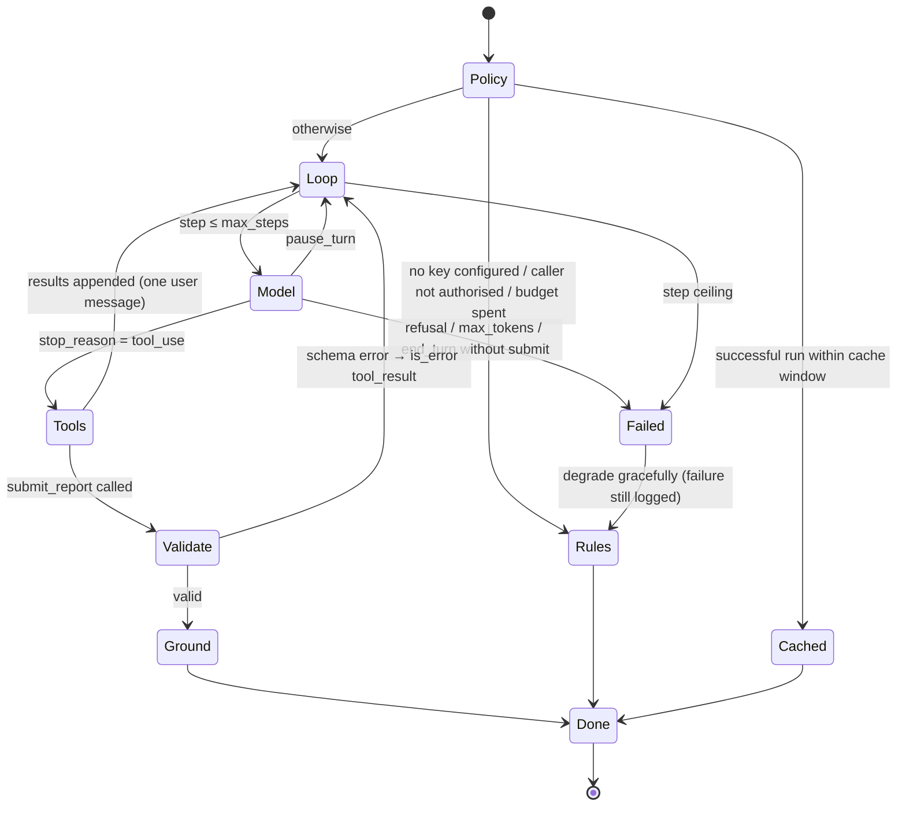

# The analyst agent

An LLM agent that writes a short research note about one stock, built so that
its output can be checked rather than trusted.

## Why an agent here, and why this shape

A single prompt with the whole report pasted in would work for a summary. The
agent shape earns its place because the model chooses what evidence to look at
and the system can then verify that what it says matches what it looked at.
That verification is the point; the tool-use loop is how it is made possible.

## Flow



## Tools

| Tool | Input | Returns |
|---|---|---|
| `get_overview` | none | quote, trailing returns, composite score/confidence/coverage/stance |
| `get_signal_breakdown` | none | per-family score, weight, contribution, reason, and the stance rule |
| `get_technicals` | none | RSI, SMAs, MACD histogram, Bollinger, ATR, stochastic |
| `get_fundamentals` | none | annual figures and the eight checks, or `available: false` |
| `get_risk` | none | volatility, drawdown, VaR/ES, Sharpe/Sortino, beta, Hurst, VR, ranges |
| `get_news` | `limit` (clamped 1–15) | headlines inside `untrusted_headlines` |
| `submit_report` | the note | terminal; validated and grounded |

All schemas are `strict: true` with `additionalProperties: false`. No tool takes
a symbol, ticker, URL or query.

Numeric results come back as flat dotted paths:

```json
{"metrics": {"risk.volatility_annual": 0.3127, "risk.max_drawdown": -0.2214, "risk.beta": 1.08}}
```

The `Toolbox` records every path/value pair it returns during the run in
`seen`. That record is what grounding checks against.

## The note

```python
class AnalystReport(BaseModel):
    stance: Literal["constructive", "neutral", "cautious", "insufficient_evidence"]
    headline: str          # 10–200 chars
    summary: str           # 40–1500 chars
    bull_points: list[str] # ≤ 5
    bear_points: list[str] # ≤ 5
    key_risks: list[str]   # ≤ 5
    cited_metrics: list[CitedMetric]  # 3–15 × {metric, value}
    confidence: float      # 0–1
```

## Grounding

For each `cited_metrics` entry:

- the path must be one the agent actually retrieved in this run — a metric the
  report contains but the agent never looked at counts as unverified, because
  the agent cannot have known it; and
- the value must match within 1% relative or 0.005 absolute — loose enough for
  rounding `0.31274 → 0.313`, tight enough to catch an invented figure.

The page shows `verified / total` with a tick or cross per citation and the
reason for each failure. The score is stored with the run, so grounding
quality can be tracked over time and across model versions.

## Guardrails

| Risk | Control |
|---|---|
| Prompt injection via headlines | Untrusted envelope; system prompt treats it as data; nothing to exfiltrate to — tools are read-only, symbol-bound, and there is no network tool |
| Tool misuse / scope creep | No free-form inputs; symbol bound server-side; `limit` clamped |
| Hallucinated figures | Grounding check on every citation, surfaced in the UI |
| Malformed output | Strict schema + Pydantic re-validation; errors returned as `is_error` tool results so the model can correct |
| Runaway loop | `STOCKLENS_AGENT_MAX_STEPS` (default 8) |
| Cost abuse | Model runs off for anonymous callers by default; per-client agent rate limit; per-symbol cache; daily budget counted in the DB |
| Model refusal | `stop_reason == "refusal"` checked before reading content; server-side refusal fallback enabled; degrade to rules |
| Upstream failure | Typed SDK exceptions (rate limit, auth, status, connection) mapped to clear errors; degrade to rules |
| Advice-shaped output | Prompt forbids buy/sell instructions and price targets; stance is an enum; every page carries the disclaimer |

## Model configuration

| Setting | Default | Why |
|---|---|---|
| `STOCKLENS_AGENT_MODEL` | `claude-opus-5-5` | Strongest reasoning over mixed quantitative evidence |
| thinking | `adaptive` | The model decides how much to reason per step |
| `STOCKLENS_AGENT_EFFORT` | `medium` | Set explicitly; raise to `high` if notes are shallow |
| `max_tokens` | 16000 | Non-streaming ceiling that avoids HTTP timeouts |
| prompt caching | automatic | Steps 2..n re-send the transcript; caching bills it at the read rate |
| refusal fallback | `fallbacks: "default"` | A declined request is retried on a fallback model inside the same call |

## Rules fallback

`rules_report` meets the same `AnalystReport` contract deterministically:
stance from the composite, bull and bear points from the strongest positive and
negative directional families, risks from VaR and drawdown, citations from the
values it read through the same `Toolbox`. Its grounding score is always 1.0 —
a useful baseline when comparing model runs.

## Evaluating the agent

The audit table makes the basic questions SQL:

```sql
-- grounding and cost by model, last 30 days
SELECT model,
       count(*)                                    AS runs,
       avg((grounding->>'score')::float)           AS avg_grounding,
       avg(input_tokens + output_tokens)           AS avg_tokens,
       avg(latency_ms)                             AS avg_latency_ms,
       sum(CASE WHEN status <> 'ok' THEN 1 END)    AS failures
FROM agent_runs
WHERE mode = 'model' AND created_at > now() - interval '30 days'
GROUP BY model;
```

A fuller eval would add: stance agreement with the composite, a held-out set of
symbols with human-graded notes, and injection canaries planted in demo
headlines.
