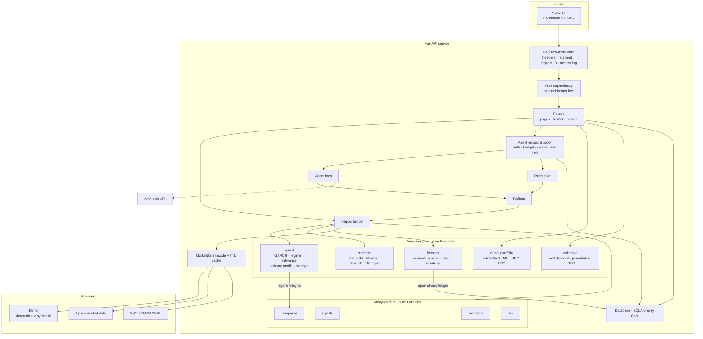
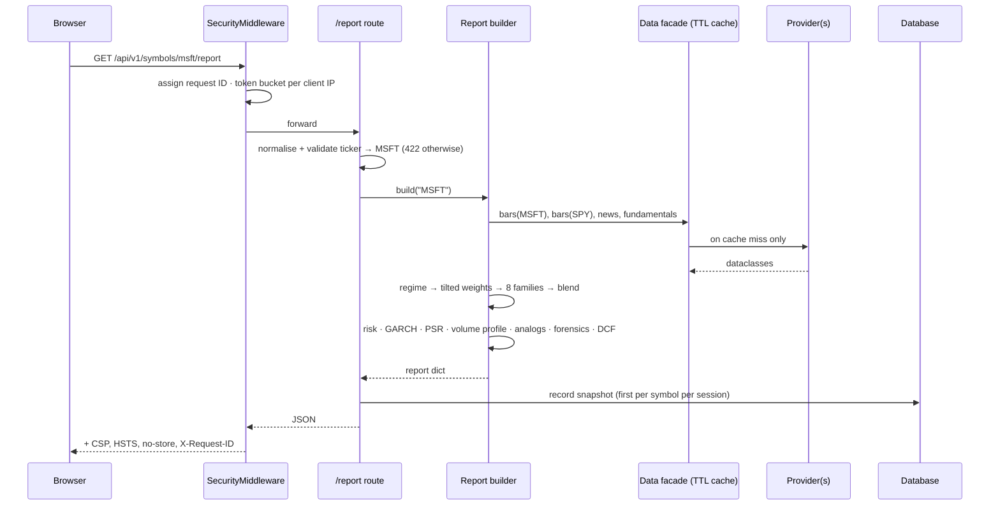

# Architecture

StockLens is one stateless HTTP service with a pure analytics core, a bounded AI
agent, and a small append-only database. This document explains the shape,
the request and agent flows, and why each boundary sits where it does.

## Components

| Module | Responsibility | Depends on |
|---|---|---|
| `config.py` | Typed settings from env; secrets as `SecretStr` | pydantic-settings |
| `security.py` | Security headers, token-bucket limiter, bearer auth, request IDs, access log | Starlette |
| `app.py` | App factory, routes, the agent endpoint's policy | everything below |
| `analytics/report.py` | Builds the single report every consumer shares | data facade, analytics |
| `analytics/{indicators,signals,composite,risk}.py` | Pure maths | nothing |
| `quant/` | Volatility models, regime, inference, volume profile, analogs, linear algebra, covariance, portfolio construction — see [QUANT.md](QUANT.md) | nothing (stdlib) |
| `forecast/` | The committed forecast, ledger resolution, Brier/reliability/block-test grading, the simulated walk-forward record ([ADR 0007](adr/0007-forecast-ledger.md)) | analytics, quant |
| `evidence/` | Per-symbol walk-forward tests of every price family | analytics, quant |
| `research/` | Forensic scores, graded red flags, multiples, DCF grid, reverse DCF, derived debate | `data.base` dataclasses only |
| `data/` | Provider protocols, adapters, TTL cache | httpx |
| `agent/` | Tools, loop, prompts, rules fallback | Anthropic SDK (lazy) |
| `db.py` | Two append-only tables | SQLAlchemy Core |
| `evaluate.py` | Walk-forward evaluation CLI | data facade, analytics |

**Dependency rule:** `analytics/`, `quant/` and `research/` import nothing from
`data/` adapters, `app`, `agent` or `db`, and nothing outside the standard
library ([ADR 0005](adr/0005-numerics-implemented-not-imported.md)). It receives plain dataclasses (`Bar`, `NewsItem`,
`Fundamentals`). That is what makes it trivially testable and reusable from a
notebook.

## Request flow: the stock page

## Agent flow

See [AGENT.md](AGENT.md) for the sequence and guardrails. The structural
point: the agent never touches a provider or the network beyond the model API.
It operates on a report built *before* the first model call, through tools that
slice that report. A run is therefore reproducible, cannot hang on an
upstream, and cannot be talked into fetching anything else.

## State

| State | Where | Lifetime | Shared across replicas? |
|---|---|---|---|
| Market data cache | in-process `TTLCache` | `STOCKLENS_CACHE_TTL_SECONDS` (300 s) | No — per replica, by design |
| Rate-limit buckets | in-process, LRU-bounded | rolling | No — edge limits are the global ceiling |
| Snapshots, agent runs | database | permanent | Yes |
| Forecast ledger | database, append-only, write-once resolution | permanent | Yes |
| Simulated records, evidence | in-process `TTLCache` | 1 hour | No — deterministic per day's data |
| Reports (dict + encoded JSON), portfolio results | in-process single-flight `TTLCache`, bounded by `STOCKLENS_CACHE_MAX_SYMBOLS` | data TTL | No — the ingress hashes on the URL so each symbol lives on one pod ([CAPACITY.md](CAPACITY.md)) |
| Agent daily budget | counted from `agent_runs` | per UTC day | Yes |
| Agent result cache | read from `agent_runs` | `STOCKLENS_AGENT_CACHE_MINUTES` | Yes |

The service holds no session state, so any replica can serve any request.
Scaling horizontally needs a shared database (PostgreSQL); a shared Redis for
the cache and limiter is the natural next step and slots in behind the same
two classes.

## Design decisions

Recorded as ADRs in [adr/](adr):

1. [Pure analytics core](adr/0001-pure-analytics-core.md)
2. [Hand-written agent loop with a terminal submit tool](adr/0002-agent-loop.md)
3. [No front-end framework, no CDN](adr/0003-no-frontend-framework.md)
4. [SQLAlchemy Core, SQLite → PostgreSQL](adr/0004-storage.md)
5. [Numerics implemented, not imported](adr/0005-numerics-implemented-not-imported.md)
6. [Regime-conditioned family weights](adr/0006-regime-conditioned-weights.md)
7. [A falsifiable forecast ledger](adr/0007-forecast-ledger.md)

## Observability

- **Logs:** one JSON object per line to stdout — `ts`, `level`, `logger`, `msg`,
  plus `request_id`, `method`, `path`, `status`, `duration_ms`, `client_ip` on
  every request, and `status`, `steps`, `input_tokens`, `output_tokens`,
  `latency_ms` on every agent run. Query strings and headers are never logged.
- **Tracing:** every response carries `X-Request-ID` (accepted from a trusted
  proxy if well-formed, otherwise generated), so an edge log line joins to the
  app log line.
- **Probes:** `/healthz` (process up) and `/readyz` (database reachable) map
  directly onto Kubernetes, Cloud Run and load-balancer health checks.
- **Audit:** `agent_runs` is the long-term record of model behaviour — cost per
  run, grounding score over time, failure rate by status.

## Extending

| To add | Do this |
|---|---|
| A data provider | Implement `PriceSource`, `NewsSource` or `FundamentalsSource` in `data/`; wire it in `build_market_data` |
| A signal family | Add a function in `analytics/signals.py` returning `Signal`; add it in `report.build`; give it a weight in `DEFAULT_WEIGHTS`; add tests for abstention and range |
| A quant estimator | Add a pure function in `quant/` returning a JSON-ready dict with `None` below its sample floor; call it in `report.build`; add a card in `web/static/panels.js`; test it on a seeded null (it should find nothing) and a seeded signal (it should find it) |
| An agent tool | Add a spec to `TOOL_SPECS` (strict, closed schema, no free-form inputs) and a branch in `Toolbox.call` that returns flat metrics via `_metrics` |
| A deploy target | Add a folder under `deploy/` with the same guarantees: TLS at the edge, non-root, read-only FS, secrets from a manager, edge rate limit |
