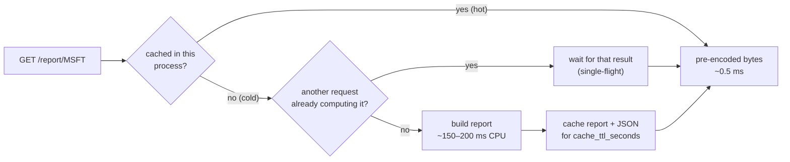
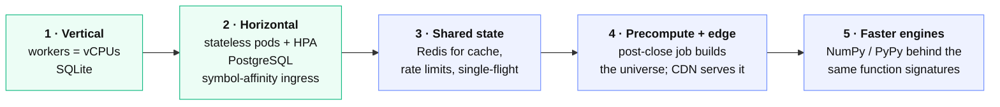

# Capacity and scaling

How much traffic StockLens serves, what limits it, and what changes — in
configuration and in code — at each step up. Every figure under **Measured** was
produced by [`scripts/benchmark.sh`](../scripts/benchmark.sh) and can be
reproduced; every figure under **Planning** is derived from those by a formula
stated beside it.

## The shape of the load

A stock report is a pure function of a symbol's inputs (bars, news, filings),
and those inputs change at most once per cache window. So there are exactly two
kinds of request, with very different costs:

| Path | What happens | Cost |
|---|---|---|
| **Hot** — the symbol's report is cached | Look up pre-encoded JSON bytes; skip ledger writes already made this session | ~0.5 ms of CPU |
| **Cold** — first request for a symbol in a cache window | Fetch inputs, run every engine (regime, 8 families, GARCH, attribution, 2,000-path simulation, forensics, DCF), encode ~90 KB of JSON, write the ledger once | ~150–200 ms of CPU |

Capacity is therefore governed by two independent numbers: **hot requests per
second** (scales with users) and **cold reports per second** (scales with how
many distinct symbols are being viewed, not with how many people view them).



## Measured

Apple M4 (10 cores), Python 3.13, demo data, file-backed SQLite, ApacheBench
with keep-alive at 64 concurrent connections **on the same machine** (so the
load generator competes for the cores it is measuring — these are conservative).
Zero failed requests in every run.

| Endpoint | 1 worker | 2 workers | 8 workers | p50 / p99 at 8 workers |
|---|---:|---:|---:|---|
| `GET /healthz` (framework ceiling) | 2,213 req/s | 4,226 | 6,457 | 10 / 20 ms |
| `GET /report` — cached | **2,008 req/s** | **3,535** | **5,741** | 11 / 22 ms |
| `GET /portfolio` (4 names) — cached | 1,615 req/s | 2,453 | 4,325 | 14 / 40 ms |
| `GET /report` — cold, unique symbol each time | **4.7 reports/s** | **7.8** | **20.3** | 709 / 2,218 ms (16 in flight) |

| Endpoint | Uncached | Cached | Cache lifetime |
|---|---:|---:|---|
| `/evidence` (re-scores ~500 sessions) | 446 ms | 2 ms | 1 hour |
| `/track-record` (12-symbol walk-forward) | 1,611 ms | 3 ms | 1 hour |
| `/portfolio` (8 names) | 67 ms | 19 ms → cached bytes | data TTL |

**Memory per worker:** ~80 MB at start plus ~0.75 MB per cached symbol (bars,
news, filings, report and its JSON). The caches are bounded by
`STOCKLENS_CACHE_MAX_SYMBOLS` (default 256); pushing 600 distinct symbols
through one worker plateaus at **271 MB**, inside the 512 Mi pod limit.

### What the measurements changed

The first load test found three problems, now fixed and covered by tests:

| Finding | Before | After |
|---|---|---|
| The report was recomputed on every request | ~7 req/s per worker | cached for the data TTL |
| ~90 KB of JSON was re-encoded on every hit, plus four ledger round-trips | 502 req/s per worker | 2,008 req/s (bytes cached; ledger work once per session) |
| A burst of requests for one cold symbol computed it once *per request* | N × 150 ms | once — single-flight cache |
| Cache size was a fixed 1,024 entries — ~760 MB, over the pod limit | OOM risk under a wide universe | bounded by a memory-derived setting |
| The Kubernetes HPA targeted 70% of a 100m CPU request | scaled out at 70 millicores | requests sized to a real CPU |

## Planning

Cloud vCPUs are slower than an M4 performance core, so planning uses **half**
the measured per-worker figures and keeps **50% headroom**:

- per vCPU: **1,000 hot req/s** and **2.5 cold reports/s**
- one active user ≈ **0.1 req/s** (one API call every ten seconds while browsing)

```
concurrent active users  ≈  (hot capacity × 0.5) / 0.1
symbols kept fresh       ≈  (cold capacity × 0.5) × cache_ttl_seconds / independent_caches
```

`independent_caches` is the number of processes that each compute a symbol for
themselves. Without symbol affinity it equals the worker count, so **adding
replicas multiplies cold work**. With the ingress hashing on the URL (the
template sets `upstream-hash-by: "$uri"`), each symbol lives on one pod and
`independent_caches = 1`.

| Tier | Deployment | vCPU | Concurrent active users | Symbols fresh every window | What changes |
|---|---|---:|---:|---|---|
| **Demo** | laptop, 1 worker, SQLite | 1 | ~5,000 | ~375 (5 min) | nothing |
| **Small** | one VM, `WEB_CONCURRENCY=4`, SQLite | 4 | ~20,000 | ~375 (4 caches) | one env var |
| **Team** | Kubernetes, 4 pods, symbol affinity, PostgreSQL | 4 | ~20,000 | ~1,500 (5 min) | `DATABASE_URL`, provided ingress |
| **Growth** | Kubernetes, HPA 2→20 pods, affinity, `CACHE_TTL_SECONDS=900` | 20 | ~100,000 | ~22,500 → the whole US listed market (~6,000) | HPA ceiling, one env var |
| **Edge** | + CDN with `PUBLIC_CACHE_SECONDS=300` | 20 | bounded by the CDN, not the origin | whole market | one env var + CDN |

Two things make the cache window a safe dial: the bars are **daily**, so a
report's inputs only change when a session closes or a headline lands; and the
response says when it was generated. Raising the window from 5 to 15 minutes
triples the universe a deployment keeps fresh at the same cost.

### Paths that do not scale with users

| Path | Bound | Why it is not a capacity concern |
|---|---|---|
| AI analyst (model mode) | model latency and **money** | Off for anonymous users by default; per-client limit; per-symbol cache; a daily budget counted in the database (`AGENT_DAILY_LIMIT`, default 50) |
| Evidence, track record | ~0.5–1.6 s per symbol per hour | Cached an hour; at 1,500 symbols that is ~0.2 CPU-seconds per second for the whole universe |
| Ledger writes | ≤ 2 rows per symbol per day | ~12,000 rows/day for the entire US market; `LEDGER_DAILY_LIMIT` caps abuse |
| Database reads on the hot path | none after the first view of a session | the ledger fast path skips them |

## The scaling path



| Stage | Status | Change required | Effect |
|---|---|---|---|
| **1 · Vertical** | ✅ ready | `WEB_CONCURRENCY` = vCPUs | ~linear in cores for hot traffic |
| **2 · Horizontal** | ✅ ready | `STOCKLENS_DATABASE_URL` → PostgreSQL; the provided K8s manifests (HPA, PDB, NetworkPolicy, affinity ingress) | stateless replicas, linear hot scaling, cold work computed once per symbol |
| **3 · Shared state** | designed | Redis-backed implementations of `TTLCache` and `RateLimiter` — both are small classes behind the interfaces every caller already uses | global rate limits; cold work once per symbol without affinity; cache survives pod restarts |
| **4 · Precompute + edge** | half ready | A scheduled job that calls `report.build` for the universe after each close (the function already exists); `PUBLIC_CACHE_SECONDS` already emits CDN headers | origin cold work moves off the request path; reads served at the edge |
| **5 · Faster engines** | designed | Swap the internals of `quant/` for NumPy where profiling says so ([ADR 0005](adr/0005-numerics-implemented-not-imported.md)) | 5–50× on the cold path; callers unchanged because the engines take lists and return dicts |

Why stages 1–2 need no code: the service holds **no session state**. Every
piece of state is either derived (caches, which any replica can rebuild) or in
the database (snapshots, the forecast ledger, agent runs, the agent budget).
Any replica can serve any request.

## Limits, stated plainly

- **One worker per CPU.** The engines are CPU-bound pure Python, so threads do
  not add throughput; processes and pods do.
- **Caches and rate limits are per process** until stage 3. Symbol affinity
  fixes the cache cost; the edge rate limit (ingress `limit-rpm`, WAF) is the
  global ceiling on abuse.
- **SQLite is single-node.** It is fine for one VM with several workers (writes
  are a few per symbol per day); use PostgreSQL as soon as there is more than one
  machine.
- **Upstream quotas** (Alpaca, SEC's 10 requests/s) are protected by the data
  cache: a symbol costs at most one upstream fetch per window per cache.

## Reproducing

```bash
pip install --require-hashes -r requirements-dev.lock -r requirements-build.lock
pip install --no-deps --no-build-isolation -e .
scripts/benchmark.sh 1     # one worker
scripts/benchmark.sh 8     # eight workers
```

The script starts StockLens on demo data with the rate limits raised (they
would otherwise, correctly, throttle a load test), warms every worker, and runs
ApacheBench plus `scripts/bench_cold.py`. Nothing leaves the machine.
