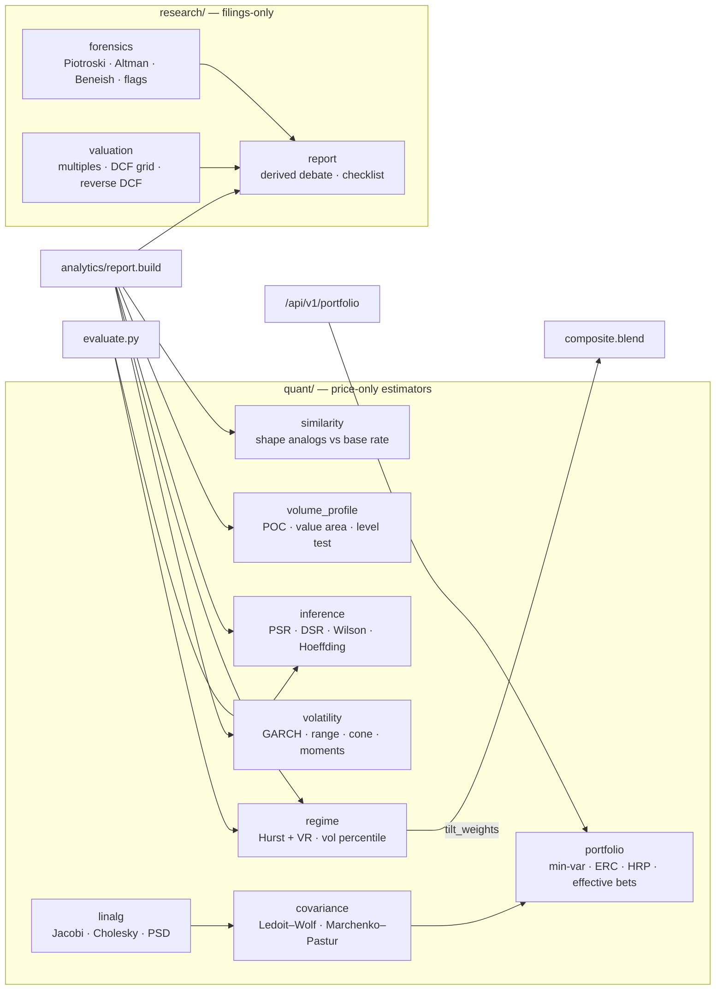

# Deep analytics

The second layer of StockLens: volatility models, regime detection, statistical
inference, market structure, factor attribution, scenario simulation, portfolio
construction, forensic accounting — and the machinery that grades all of it:
the forecast ledger and the evidence lab.
Every module is pure Python over plain lists and dataclasses — no NumPy, SciPy
or pandas (see [ADR 0005](adr/0005-numerics-implemented-not-imported.md)) — and
every module follows the same three rules as the scoring core:

1. **Withhold below a sample floor.** GARCH needs 250 returns, the Sharpe
   inference 60, a level test 15 touches a side. Below that the field is `None`
   and the page shows `—`.
2. **Every estimate carries the test that would refute it.** The analog search
   reports its base rate, the volume levels an out-of-sample test, the Sharpe
   ratio its probability of being above zero.
3. **Noise is the null hypothesis.** On demo data — a factor model with no
   expected-return signal by construction — every "is this real?" test should
   say no. That is checked: analog significance fires on 10 of 200 demo
   tickers (nominal 5%), and regime detection calls 100 of 100 random walks
   "random".



## Regime (`quant/regime.py`)

The same signal means opposite things in different regimes: buying an oversold
RSI pays in a mean-reverting market and is how money is lost in a trending one.
So the regime is estimated first, and it decides how much to trust each family.

| Measure | Definition | Noise band (random walk) |
|---|---|---|
| Hurst | Rescaled range with the Anis–Lloyd expected-R/S correction and Peters' (n−½)/n factor | 0.475 ± 2·max(0.03, 1/√n) — centre and spread from 300 simulated walks |
| Variance ratio | Lo–MacKinlay overlapping VR(5) | 1 ± 2·SE, asymptotic SE under homoskedasticity |
| Volatility regime | today's 21-session realised vol as a percentile of its own rolling history | < 20th low, > 80th high |

A trend regime is asserted **only when both measures are outside their bands
and agree**. One weak measure, or two that disagree, returns `random` — two
weak measures pointing different ways are not evidence.

**Regime-conditioned weights** (`tilt_weights`), picked not fitted, bounded to
0.5–1.5×, renormalised so the total weight is unchanged:

| Family | Trending | Mean-reverting | Random |
|---|---|---|---|
| technical (RSI-led, short-horizon reversion) | ×0.65 | ×1.35 | ×1 |
| momentum (12-1) | ×1.35 | ×0.70 | ×1 |
| relative strength | ×1.25 | ×0.80 | ×1 |
| fundamental, valuation, sentiment | ×1 | ×1 | ×1 |

The composite exposes `base_weights`, `regime_weights` and `regime`, so the
tilt is visible on the page and in the agent's `get_signal_breakdown`. Whether
the tilt earns its place is a question for `stocklens-evaluate`, which runs
every statistic under both weightings (`regime_conditioned`, `regime_ic_delta`).

Measured sensitivity is modest: returns with lag-1 autocorrelation 0.3 are
called trending 29% of the time at 500 bars; at 0.6 and 1,000 bars, 40 of 40.
The detector is built to rarely cry wolf, and pays for it in power.

## Volatility (`quant/volatility.py`)

**GARCH(1,1)** — σ²ₜ = ω + α·ε²ₜ₋₁ + β·σ²ₜ₋₁ on demeaned daily log returns,
maximum likelihood (Gaussian), α + β < 1 enforced. The optimiser is a coarse
grid with ω variance-targeted, refined by a three-parameter pattern search with
ω in log space — slower than BFGS and transparent about where it can fail.
Reported: α, β, persistence, half-life ln ½ / ln(α+β), long-run vol
√(ω/(1−α−β)·252), today's conditional vol, and the closed-form **average
variance forecast** over 5/21/63/126 sessions, which decays geometrically from
today's conditional variance toward the long-run level.

| Estimator | Uses | Note |
|---|---|---|
| Close-to-close | C | the baseline |
| Parkinson (1980) | H, L | ~5× more efficient on a continuous path; reads low on stocks that gap, because it ignores the overnight move |
| Garman–Klass (1980) | O, H, L, C | same caveat |

**Volatility cone** — 10th/50th/90th percentile of rolling realised vol at
10/21/63-session windows over the whole history, with today's reading and its
percentile. A reading near the top of the cone has historically tended to
mean-revert.

**Distribution** — skewness, excess kurtosis, Jarque–Bera (rejects at χ²₂ 5% =
5.99), lag-1 autocorrelation, and the Ulcer index (Martin 1987: RMS drawdown in
percentage points), which penalises long underwater stretches that maximum
drawdown, a single point, does not see.

## Inference (`quant/inference.py`)

**Probabilistic Sharpe ratio** (Bailey & López de Prado 2012) — the probability
the true Sharpe exceeds a benchmark, given the sample length and the returns'
skew γ₃ and kurtosis γ₄:

```
PSR = Φ( (SR − SR*) · √(n − 1) / √(1 − γ₃·SR + (γ₄ − 1)/4 · SR²) )     (SR per period)
```

**Deflated Sharpe ratio** (2014) replaces SR* by the expected maximum Sharpe
of `n_trials` independent noise strategies (Euler–Mascheroni approximation), so
a Sharpe found by searching is charged for the search. **Minimum track record
length** inverts the PSR: the sessions needed for 95% confidence that the
Sharpe is positive.

**Intervals on a hit rate** — Wilson score (near-nominal coverage at small n),
Hoeffding (distribution-free, holds at every n, deliberately wider), Bernstein
(variance-aware), and the normal interval for comparison. `bonferroni_threshold`
and `expected_false_survivors` quantify multiple testing. The evaluation
harness reports Wilson and Hoeffding on its independent days; a hit-rate
interval that contains the base rate is no evidence of skill.

## Volume at price (`quant/volume_profile.py`)

Every indicator in the core is a function of *time*. This is a function of
*price level*: where the stock actually changed hands, and where it did not.

- 40 bins over the last 252 sessions. Each bar's volume is spread over the
  bins its high–low range overlaps, in proportion to the overlap — daily bars
  carry no intraday distribution, so uniform is the assumption, stated on the
  page. Total volume is conserved exactly.
- **Point of control** — the bin with most volume. **Value area** — expanded
  from the POC by the larger neighbour until it holds 70% of volume.
- **High/low volume nodes** — local peaks/troughs standing out by ≥ 10% of the
  POC bin's volume; edge bins are never low-volume nodes.
- **Level test** — levels (POC + HVNs) are built on the first 70% of the window
  and tested on the last 30%. A *touch* is a bar whose range comes within half
  a bin of a level; a *reaction* is the close five sessions later being on the
  side price came from. The base rate is the same measurement at ≥ 12 control
  prices spaced evenly over the test range, away from the real levels. No RNG.
  Fewer than 15 touches on either side: withheld, "not a result either way".

## Shape analogs (`quant/similarity.py`)

The latest 30-session log-price path is z-normalised and compared by Euclidean
distance with every earlier window of the symbol's own history. The 10 nearest
are kept subject to an **exclusion zone** (each at least one window from the
query and from each other) and a complete 21-session forward return.

Their mean forward return is compared with the **base rate** — every
21-session return in the same history. Under the null, analogs are draws from
that base distribution, so the standard error is the base-rate spread / √k.
(Using the ten matches' own spread instead was measured to fire on 9% of demo
random walks; the base-rate SE brings it to 5%.) `significant` needs ≥ 10
analogs and |edge| > 2 SE, and the page always carries the warning: the search
manufactures close matches by construction, so a close match is not evidence.

## Portfolio lab (`quant/{linalg,covariance,portfolio}.py`, `GET /api/v1/portfolio`)

**Why shrinkage.** With N symbols and T observations, the smallest eigenvalues
of a sample covariance are wrong by a large factor even at q = N/T = 0.03, and a
minimum-variance optimiser loads almost entirely on exactly those. So:

- **Ledoit–Wolf (2004) constant-correlation shrinkage** — the full estimator
  including the ρ̂ term (omitting it biases the intensity toward 1). Intensity
  is estimated from the data, not tuned.
- **Marchenko–Pastur** — the eigenvalue range of a pure-noise correlation
  matrix, λ± = (1 ± √q)². Eigenvalues above λ₊ are structure; the rest are
  indistinguishable from noise. The spectrum is computed on the *sample*
  correlation because the band describes sample spectra.
- **Eigendecomposition** by cyclic Jacobi rotations, `nearest_psd` by clipping
  eigenvalues, Cholesky with a failure return rather than an exception.

**Five constructions**, all long-only, all summing to 1:

| Method | Rule | Failure mode |
|---|---|---|
| Equal weight | 1/N | ignores risk entirely, which is also why it cannot be wrong about risk |
| Inverse volatility | wᵢ ∝ 1/σᵢ | ignores correlation |
| Minimum variance | min wᵀΣw, FISTA projected gradient onto the simplex | piles into the quietest names: corners |
| Equal risk contribution | every wᵢ(Σw)ᵢ equal, cyclical coordinate descent (Griveau-Billion & Roncalli 2013) | equals inverse vol under constant correlation |
| Hierarchical risk parity | López de Prado (2016): distance √((1−ρ)/2), distance-of-distances, single linkage, quasi-diagonalisation, recursive bisection by inverse-variance | single linkage chains |

Each method reports volatility, **effective number of bets** (Meucci 2009: the
exponential of the entropy of variance contributions across uncorrelated
principal directions), risk contributions summing to 1, the diversification
ratio Σwᵢσᵢ / σₚ, and the largest weight. On a 10-name demo basket, one factor
sits above the noise band and equal weight holds 1.3 effective bets; minimum
variance reaches 2.9.

## Research (`research/`)

Built from SEC XBRL company facts. `Fundamentals` now carries the prior fiscal
year for every field (`prior`) and up to five annual points for revenue,
earnings, cash flow, capex and diluted shares (`history`). "Unknown" is a
first-class answer everywhere: an untestable Piotroski signal is not a fail.

| Score | Model | Verdict line |
|---|---|---|
| **Piotroski F** (2000) | 9 binary tests: ROA > 0, CFO > 0, ΔROA > 0, CFO/A > ROA, Δleverage < 0, Δcurrent ratio > 0, no dilution, Δgross margin > 0, Δasset turnover > 0 | total withheld below 7 testable |
| **Altman Z''** (1995) | 6.56·WC/TA + 3.26·RE/TA + 6.72·EBIT/TA + 1.05·BE/TL; 1968 Z alongside when market cap is known | distress < 1.1, safe > 2.6 |
| **Beneish M** (1999) | 8-variable (DSRI, GMI, AQI, SGI, DEPI, SGAI, LVGI, TATA); falls back to the 5-variable model with its own −2.22 cut-off when inputs are missing, and says so | 8-variable flag > −1.78 |
| **Sloan accruals** (1996) | (net income − CFO) / average assets | raised above 10% |

**Red flags, graded** — cash conversion, dilution, stock compensation share of
operating cash flow, effective tax rate, accumulated deficit, interest cover,
receivables and inventory growing faster than revenue. Each carries the
measured value, the line, and a severity in [0.25, 1] by distance past it —
failing a leverage test by 15% and a dilution test by 6× are not the same news.

**Valuation** — multiples (P/E, P/S, P/B, EV/EBIT, EV/Sales, FCF and earnings
yield; forward P/E withheld with the reason). A two-stage DCF on free cash
flow per share whose **output is the grid** — discount 7–12% × terminal growth
1.5–4% — with the terminal-value share printed, because terminal value is most
of every cell and no single fair value is honest. The **reverse DCF** bisects
for the constant 10-year growth the current price implies at 9% / 2.5% and
prints it next to realised revenue CAGR.

**The debate is derived, not written.** Each bull or bear point is a
measurement on the page arguing for its side; passed red-flag checks fold into
one bull line, each raised flag is its own bear point. A short bear case for
clean accounts is the correct output.

## Forecast ledger and track record (`forecast/`, ADR 0007)

The model commits, on every report, to `p_up = 0.5 + 0.5·tanh(0.35·score)` over
21 sessions (price families, regime-tilted weights) and a one-sigma range
`price·exp(±σ_EWMA·√21)`. One row per symbol per session per model version,
written before the outcome exists and resolved write-once.

| Measure | Definition | Why |
|---|---|---|
| Brier score | mean (p − y)² | proper scoring rule: rewards honest probabilities |
| Brier skill | 1 − Brier / Brier(climatology) | climatology quotes the base rate every time; > 0 is information |
| Reliability | 4 bins of p, observed frequency with Wilson 95% | "when it says 60%, is it 60%?" |
| Range coverage | share inside the 1σ range vs 68.27% | grades the volatility, separately from direction |
| Effective sample | distinct decision days | same-day forecasts share one market |
| Block test | per-day Brier gain, averaged over consecutive 21-session blocks, t ≥ 2 over ≥ 8 blocks | the gate on "skill" and "worse than climatology" |

On the demo factor model the simulated record over the 12-name basket scores
Brier skill −0.005, hit rate 54% against 54% for always-up, t = −0.3 — the
correct "no skill".

## Evidence lab (`evidence/`, `GET /api/v1/symbols/{s}/evidence`)

For each price family and the blended price composite, re-scored at every
session from bars up to that day only (trailing 300-bar window):

- **Rank IC** with forward 5- and 21-session returns, on all days and on
  non-overlapping days, with a t-statistic on the latter.
- **Two resampling tests.** A permutation test shuffles forward returns
  against scores; a **circular-shift test** slides the whole return series past
  the scores by every offset ≥ h, which keeps both series' autocorrelation. A
  slow-moving score built from the same returns it is tested on fooled the
  permutation test 7–9% of the time on random walks; the verdict uses the
  larger p.
- **Multiple testing.** families × horizons × rules tests (16 with a
  benchmark) set a Bonferroni α of 0.05/16 = 0.0031.
- **Rule economics.** Long/flat (score > 0.15) and long/short, position set at
  the close and earning the next session, 10 bps per unit of position change;
  annual return, Sharpe, drawdown, turnover, exposure; PSR and a **deflated
  Sharpe** charged for every test run.
- **By score band** (monotonicity), **by year** and **by regime**.
- **"Works here"** needs t ≥ 2, resampling p below α and DSR > 0.95.
  "Evidence against" mirrors it with the inverted rule. On 20 demo symbols and
  40 random walks, neither fires.

## Drivers (`quant/factors.py`, `quant/scenarios.py`)

**Attribution.** OLS of daily log returns on the market and on the sector fund
orthogonalised to the market (only the slope is removed, so a sector's
outperformance is credited to the sector, not the stock's alpha). Standard
errors are **Newey–West** with lag ⌊4(T/100)^(2/9)⌋ and a T/(T−k) correction.
Reported: alpha with HAC t, betas, R², variance shares (market / sector /
idiosyncratic, summing to 1), a rolling 63-session beta, a 252-session
cumulative return decomposition whose parts sum exactly to the total,
**upside vs downside beta**, and **tail dependence** — P(stock in its worst 5%
of days | market in its worst 5%) against 5% if independent. The sector comes
from a curated mega-cap map, then the SEC SIC code (submissions API) rolled up
to the 11 SPDR sectors.

**Filtered historical simulation** (Barone-Adesi et al. 1999). GARCH(1,1)
standardised residuals are bootstrapped through the GARCH recursion from today's
conditional variance: 2,000 paths × 63 sessions in ~0.1 s, zero drift by
design. Per horizon: 5/25/50/75/95th price percentiles, P(up), P(±10%),
expected shortfall — each beside a constant-vol normal model, so the fat-tail
effect is visible as a ratio.

**Market shocks.** For a −20% … +10% market month: expected move from the
downside or upside beta, a ±1σ band from everything the market does not
explain, and the stock's median return in past 21-session windows when the
market moved within ±2.5 pp of that size (overlapping, so `n` is not
independent and says so).

## References

- Ledoit, O. & Wolf, M. (2004). Honey, I shrunk the sample covariance matrix. *Journal of Portfolio Management* 30(4).
- Marchenko, V. & Pastur, L. (1967). Distribution of eigenvalues for some sets of random matrices. *Mat. Sbornik*.
- Meucci, A. (2009). Managing diversification. *Risk* 22(5).
- López de Prado, M. (2016). Building diversified portfolios that outperform out of sample. *Journal of Portfolio Management* 42(4).
- Griveau-Billion, T., Richard, J.-C. & Roncalli, T. (2013). A fast algorithm for computing high-dimensional risk parity portfolios.
- Bollerslev, T. (1986). Generalized autoregressive conditional heteroskedasticity. *Journal of Econometrics* 31(3).
- Parkinson, M. (1980); Garman, M. & Klass, M. (1980). Estimators of security price volatility. *Journal of Business* 53(1).
- Anis, A. & Lloyd, E. (1976). The expected value of the adjusted rescaled Hurst range. *Biometrika* 63(1).
- Bailey, D. & López de Prado, M. (2012). The Sharpe ratio efficient frontier. *Journal of Risk* 15(2); (2014) The deflated Sharpe ratio. *Journal of Portfolio Management* 40(5).
- Hoeffding, W. (1963). Probability inequalities for sums of bounded random variables. *JASA* 58(301).
- Piotroski, J. (2000). Value investing: the use of historical financial statement information. *Journal of Accounting Research* 38.
- Altman, E. (1968). *Journal of Finance* 23(4); Altman, Hartzell & Peck (1995), emerging-markets Z''.
- Beneish, M. (1999). The detection of earnings manipulation. *Financial Analysts Journal* 55(5).
- Sloan, R. (1996). Do stock prices fully reflect information in accruals and cash flows? *The Accounting Review* 71(3).
- Brier, G. (1950). Verification of forecasts expressed in terms of probability. *Monthly Weather Review* 78(1).
- Newey, W. & West, K. (1987). A simple, positive semi-definite, heteroskedasticity and autocorrelation consistent covariance matrix. *Econometrica* 55(3).
- Barone-Adesi, G., Giannopoulos, K. & Vosper, L. (1999). VaR without correlations for portfolios of derivative securities. *Journal of Futures Markets* 19(5).
- Harvey, C., Liu, Y. & Zhu, H. (2016). … and the cross-section of expected returns. *Review of Financial Studies* 29(1) (multiple testing).
- Martin, P. & McCann, B. (1989). *The Investor's Guide to Fidelity Funds* (Ulcer index).
