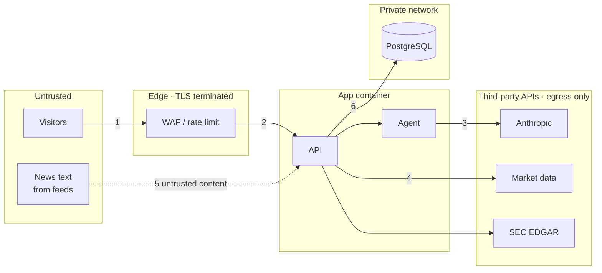

# Security architecture

## Scope and assets

StockLens is read-only analytics. It holds no user accounts, no personal data, no
brokerage credentials and no order path. What is worth protecting:

| Asset | Why it matters |
|---|---|
| Anthropic API key | Direct financial cost if abused |
| Market-data keys | Account suspension, quota exhaustion |
| Optional site API key | Gate on the whole API |
| Database contents | Integrity of the forecast ledger and agent audit trail |
| Availability | A public demo that falls over is a bad demo |
| Visitors' browsers | XSS via third-party news text would execute on the site's origin |

## Trust boundaries



1. Internet → edge: TLS 1.2+, WAF rules, per-IP limits.
2. Edge → app: only the proxy can reach the app port; the app re-enforces limits and headers.
3. App → model: outbound HTTPS with a secret from a manager; prompts contain no secrets.
4. App → data vendors: read-only endpoints, validated tickers only.
5. Third-party text enters as data and is rendered as text, never markup or instructions.
6. App → DB: private network, credentials from a secret manager.

## Threat model (STRIDE)

| Threat | Example | Mitigation |
|---|---|---|
| **Spoofing** | Forged `X-Forwarded-For` to dodge rate limits | Header ignored unless `STOCKLENS_TRUST_PROXY_HEADERS=true`; proxies overwrite, never append (nginx template); test covers it |
| | Guessing the API key by timing | `hmac.compare_digest` |
| **Tampering** | Ticker used to rewrite an upstream URL (`AAPL/../v2/account`) | Allowlist regex `^[A-Z]{1,5}([.-][A-Z]{1,2})?$` before any use; length-bounded path param |
| | Prompt injection in a headline | Untrusted envelope; read-only, symbol-bound tools; no network or write tool exists |
| | SQL injection | SQLAlchemy Core with bound parameters only; no string-built SQL |
| **Repudiation** | "The AI said X" with no record | `agent_runs` stores every run, trace, tokens, grounding; request IDs in every log line |
| **Information disclosure** | Stack traces with internals | Generic 500 with request ID; detail only in logs |
| | Secrets in logs or reprs | `SecretStr`; upstream error bodies never echoed; access log omits query and headers |
| | Clickjacking, MIME sniffing, referrer leakage | `frame-ancestors 'none'`, `X-Frame-Options: DENY`, nosniff, strict referrer policy |
| | XSS from news text | Every DOM node via `textContent`; CSP forbids inline script; links restricted to http(s) and `rel=noopener noreferrer nofollow` |
| **Denial of service** | Request floods | Edge limits (nginx `limit_req`, Cloud Armor, WAF, ingress annotations) + in-app token bucket |
| | Cost exhaustion through the agent | Model runs need a key by default; per-client agent limit; per-symbol cache; DB-counted daily budget; step ceiling |
| | Upstream slowness | httpx timeouts on every call; TTL cache; bounded pagination |
| | Memory exhaustion | LRU-bounded limiter and cache; container memory limits; request body limits at the edge |
| **Elevation of privilege** | Container escape after an RCE | Non-root UID 10001, read-only root FS, all capabilities dropped, no-new-privileges, seccomp RuntimeDefault, PSA `restricted`, no service-account token |
| | Lateral movement | Default-deny NetworkPolicy; DB reachable only from the app; app reachable only from the ingress |

## Network design

### Kubernetes

```
ingress-nginx ──8080──▶ stocklens pods ──5432──▶ postgres
                              │
                              ├──53──▶ kube-dns
                              └──443─▶ internet (RFC1918 and 169.254.0.0/16 excluded)
```

`169.254.0.0/16` is excluded so a compromised pod cannot reach the cloud
metadata service. NetworkPolicy cannot match hostnames; for a strict FQDN
allowlist, use Cilium `toFQDNs` or an egress gateway:

```yaml
apiVersion: cilium.io/v2
kind: CiliumNetworkPolicy
metadata: { name: stocklens-egress-fqdn, namespace: stocklens }
spec:
  endpointSelector: { matchLabels: { app: stocklens } }
  egress:
    - toFQDNs:
        - matchName: api.anthropic.com
        - matchName: data.alpaca.markets
        - matchName: data.sec.gov
        - matchName: www.sec.gov
      toPorts: [{ ports: [{ port: "443", protocol: TCP }] }]
```

### Single VM

| Direction | Allowed | Everything else |
|---|---|---|
| In | 22/tcp (admin IP only, or rate-limited), 80/tcp, 443/tcp | denied |
| Out | 53 (DNS), 123/udp (NTP), 443/tcp | denied |

The app binds `127.0.0.1:8080`; `firewall.sh` fails if anything listens on
8080 on all interfaces. The systemd unit adds a filesystem, syscall and
capability sandbox (`ProtectSystem=strict`, `SystemCallFilter=@system-service`,
`CapabilityBoundingSet=` empty, `MemoryDenyWriteExecute`).

### AWS

| Security group | Inbound | Outbound |
|---|---|---|
| `alb-sg` | 443 from anywhere | 8080 → `app-sg` |
| `app-sg` | 8080 from `alb-sg` | 443 via NAT, 5432 → `db-sg` |
| `db-sg` | 5432 from `app-sg` | none |

### Google Cloud

Cloud Run behind an HTTPS load balancer with Cloud Armor: OWASP preconfigured
WAF rules, a 5-per-minute throttle on the agent endpoint, and a rate-based ban
across the site (`deploy/cloudrun/cloud-armor.sh`). Set Cloud Run ingress to
`internal-and-cloud-load-balancing` so the `run.app` URL cannot bypass the WAF.

## Secrets

| Platform | Store | Injected as |
|---|---|---|
| Local | `.env` (gitignored) | env |
| VM | `/etc/stocklens/stocklens.env`, mode 0600, root-owned | systemd `EnvironmentFile` |
| Kubernetes | External Secrets / Sealed Secrets / CSI driver | `secretRef` |
| Cloud Run | Secret Manager | `--set-secrets` |
| AWS | Secrets Manager | ECS `secrets` / App Runner `RuntimeEnvironmentSecrets` |
| Azure | Key Vault | `keyvaultref:` with managed identity |

Rotation needs no code change: every secret is read at start-up, so rotate in
the store and roll the deployment.

## Supply chain

- Dependencies pinned by range in `pyproject.toml`; Dependabot for pip, Docker and Actions.
- CI: `pip-audit` (known CVEs), `bandit` (Python SAST), CodeQL (Python and JavaScript), `gitleaks` (secrets in history), Trivy (image CVEs, fails on fixable HIGH/CRITICAL).
- Pre-commit: ruff, gitleaks, private-key detection.
- Image: multi-stage, slim base, no compilers or pip in the runtime layer. Pin base images and deploy images by digest in production.
- The UI loads nothing from third-party origins.

## Residual risks

- In-process rate limits are per replica; the edge limit is the global ceiling.
- The agent's daily budget is checked then incremented, not atomically; under a
  burst of concurrent first runs it can be exceeded by the concurrency level.
  A `SELECT … FOR UPDATE` counter row or Redis `INCR` closes this.
- `/docs` (Swagger UI) needs a looser CSP for its CDN bundle. Disable it in
  production if not wanted (`docs_url=None`) or front it with auth.
